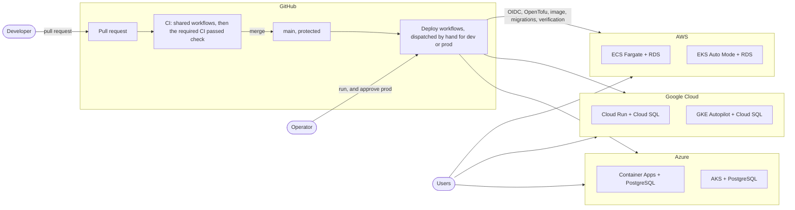
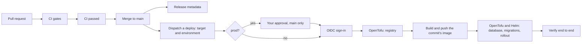
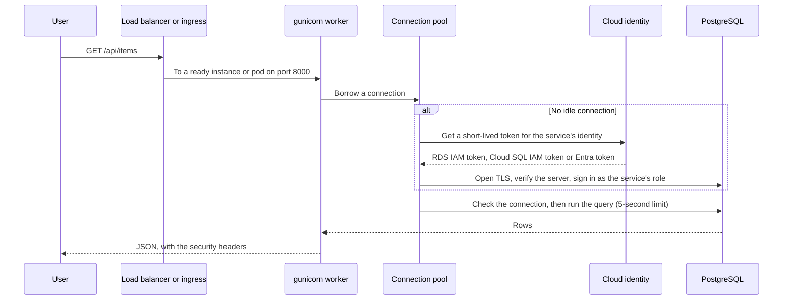

# Architecture

One Flask service backed by PostgreSQL, one container image, and six deployment targets across
three clouds: a serverless container platform on each (ECS Fargate, Cloud Run, Azure Container
Apps) and Kubernetes on each (EKS Auto Mode, GKE Autopilot, AKS) through a single Helm chart.
Every target gets its own private, managed PostgreSQL database. OpenTofu creates every cloud
resource, the shared workflows in
[github-cicd-workflows](https://github.com/Naresh1401/github-cicd-workflows) gate every change,
and every deployment is a manually dispatched, OIDC-authenticated run that ends by checking the
live service end to end.

This page is the overview. Each cloud has its own page with every resource, the deployment flow
step by step, and commands to check a deployment:

| Page | Covers |
| --- | --- |
| [aws-architecture.md](aws-architecture.md) | ECS Fargate and EKS Auto Mode, with RDS |
| [gcp-architecture.md](gcp-architecture.md) | Cloud Run and GKE Autopilot, with Cloud SQL |
| [azure-architecture.md](azure-architecture.md) | Container Apps and AKS, with Azure Database for PostgreSQL |
| [kubernetes-architecture.md](kubernetes-architecture.md) | The Helm chart, its migration hook and the Kubernetes deployment flow |
| [database.md](database.md) | How the service connects, signs in and migrates its schema |
| [AWS](aws-deployment.md), [GCP](gcp-deployment.md), [Azure](azure-deployment.md) and [Kubernetes](kubernetes-deployment.md) deployment guides | One-time setup, configuration and tear-down |
| [production-checklist.md](production-checklist.md) | What to check before calling a deployment production |

- [The whole system](#the-whole-system)
- [The six targets](#the-six-targets)
- [From a commit to production](#from-a-commit-to-production)
- [What CI checks](#what-ci-checks)
- [How a deployment runs](#how-a-deployment-runs)
- [How a request is served](#how-a-request-is-served)
- [Identities](#identities)
- [Environments and state](#environments-and-state)
- [Check everything yourself](#check-everything-yourself)
- [Design decisions](#design-decisions)
- [Trade-offs and next steps](#trade-offs-and-next-steps)

## The whole system

## The six targets

| Target | OpenTofu | Workflow | Runs on | Takes traffic | Database | Service signs in with | Migrations run as |
| --- | --- | --- | --- | --- | --- | --- | --- |
| ECS Fargate | [`infra/aws`](../infra/aws) | Deploy to AWS | Fargate tasks in private subnets | Application Load Balancer | RDS for PostgreSQL | RDS IAM token (task role) | A `migrate` container in each task, with the RDS administrator's password |
| EKS Auto Mode | [`infra/eks`](../infra/eks) | Deploy to Kubernetes, `eks` | Auto Mode nodes in private subnets | Network Load Balancer | RDS for PostgreSQL | RDS IAM token (EKS Pod Identity) | A Helm hook Job with its own Pod Identity role |
| Cloud Run | [`infra/gcp`](../infra/gcp) | Deploy to GCP | Cloud Run, Direct VPC egress | Cloud Run's HTTPS URL | Cloud SQL for PostgreSQL | IAM, as its service account | A Cloud Run job with its own service account |
| GKE Autopilot | [`infra/gke`](../infra/gke) | Deploy to Kubernetes, `gke` | Autopilot nodes with no public IPs | Network Load Balancer | Cloud SQL for PostgreSQL | IAM, through Workload Identity Federation | A Helm hook Job with its own service account |
| Container Apps | [`infra/azure`](../infra/azure) | Deploy to Azure | Container Apps in a virtual network | Container Apps' HTTPS ingress | Azure Database for PostgreSQL | Entra token, its managed identity | A Container Apps job whose identity administers the server |
| AKS | [`infra/aks`](../infra/aks) | Deploy to Kubernetes, `aks` | Autoscaling node pool, Azure CNI overlay | Azure Standard Load Balancer | Azure Database for PostgreSQL | Entra token, through Workload ID | A Helm hook Job with the administrator identity |

Every database runs PostgreSQL 17, has no public endpoint, requires TLS, and in `prod` runs
highly available with 14 days of backups and deletion protection. The database code and
migrations are shared by all six; see [database.md](database.md). The shared OpenTofu for each
cloud's database lives in [`infra/modules`](../infra/modules).

## From a commit to production

1. **Pull request.** Every change, Dependabot's too, runs the CI gates below.
2. **Merge.** `main` is protected by a ruleset: changes go in only through pull requests whose
   `CI passed` check succeeded, and `main` can't be force-pushed or deleted.
3. **Release metadata.** On `main`, CI records the repository, commit, run and time as a build
   artifact kept 90 days.
4. **Deploy.** Someone runs one of the four deploy workflows and picks `dev` or `prod`. `prod`
   waits for an approval in its GitHub Environment and only deploys from `main`. Runs for the same
   target and environment queue rather than overlap.

## What CI checks

Every job of [ci.yml](../.github/workflows/ci.yml) calls a shared workflow, except the last two:

| Job | Check | What it runs |
| --- | --- | --- |
| `python` | Lint, test and audit | ruff lint and format check; pytest against a real PostgreSQL 17 from docker compose, with 100% line and branch coverage of `app/`; pip-audit on every installed package, failing on known vulnerabilities |
| `repo-lint` | Lint workflows, scripts and Dockerfile | actionlint with shellcheck on the workflows' scripts, shellcheck on `scripts/`, hadolint on the Dockerfile |
| `infrastructure` | OpenTofu | For each of the six targets and three database modules: `tofu fmt`, `tofu validate`, and `tofu test`, which plans it against mock cloud providers and checks the settings the architecture pages describe. Then a Trivy scan of all OpenTofu, the Dockerfile and the Helm chart, failing on high or critical findings |
| `container` | Image | Builds the image, checks it runs as a non-root user, starts it and checks `/health` reports the commit, and scans it with Trivy, failing on fixable high or critical vulnerabilities |
| `helm` | Helm chart | `helm lint` and `kubeconform` for every values combination; then installs the chart on a kind cluster with a PostgreSQL, where the migration hook must succeed and `/ready` must report the commit and a working database, and runs `helm test` |
| `ci-passed` | CI passed | Succeeds only if every job above did; the one check branch protection requires |
| `release` | Record release metadata | On `main` only: uploads the release metadata |

Every third-party action is pinned to a commit SHA, and Dependabot proposes updates to actions,
Python packages, the Docker base image and the compose file's images.

## How a deployment runs

All four deploy workflows follow the same shape; each cloud's page has the exact steps:

| Stage | ECS | Cloud Run | Container Apps | EKS, GKE, AKS |
| --- | --- | --- | --- | --- |
| Guard | `prod` only from `main`, after approval | the same | the same | the same |
| Sign in | GitHub OIDC to an IAM role | to a service account through Workload Identity Federation | to an Entra app | the cloud's OIDC sign-in |
| State | `tofu init` against the environment's state file | the same | the same | the same |
| Registry first | ECR | Artifact Registry | Registry, network, environment and identities | Created with the cluster |
| Image | Built from the commit, tagged with its SHA, pushed | the same | the same | the same |
| Database and migrations | Each new task's `migrate` container | A Cloud Run job OpenTofu runs and waits for | A Container Apps job the workflow starts and waits for | A Helm pre-upgrade hook Job |
| Rollout | ECS rolling deployment, rolled back by the circuit breaker on failure | A new revision once `/ready` passes | A new revision once `/ready` passes | Rolling update; pods join once `/ready` passes |
| Verify | [scripts/verify-deployment.sh](../scripts/verify-deployment.sh) through the load balancer | through the service URL | through the app URL | through a port-forward, then through the load balancer |

The verification checks that the commit is serving, the database answers, the security headers
are set, errors come back as JSON, and the items API reads, and in `dev` writes and reads back.
Its results appear as a table in the run's summary.

## How a request is served

Each gunicorn worker keeps its own small pool (two connections, two more under load), and a
connection is checked before reuse. When the database can't be reached the service answers 503
with `Retry-After`, `/ready` turns 503 so traffic moves away, and `/health` stays 200 so nothing
restarts. Details are in [database.md](database.md).

## Identities

No long-lived secret is stored in GitHub or given to the service:

| Who | Proves who it is with | Gets |
| --- | --- | --- |
| A deploy workflow | The job's GitHub OIDC token, trusted only for this repository's `dev` and `prod` environments | Temporary credentials for the cloud's deploy identity |
| The service | Its platform's workload identity: ECS task role, EKS Pod Identity, a Cloud Run or GKE service account, an Azure managed identity | Short-lived database tokens for its own role, which can only read and write rows |
| The migrations | A separate identity of their own | Schema changes. On AWS this is the RDS administrator, whose password RDS generates, keeps in Secrets Manager and rotates; only the migration may read it |
| Kubernetes nodes and Container Apps | Their managed identities | Image pulls from their own registry only |

## Environments and state

`dev` and `prod` are GitHub Environments: each holds its own variables and secrets, `prod`
requires an approval and accepts only `main`. Every resource name includes the environment, so
both can share an account, project or subscription, and each target keeps one state file per
environment:

| Target | State |
| --- | --- |
| ECS | `s3://<AWS_TF_STATE_BUCKET>/<AWS_SERVICE_NAME>/<environment>/ecs.tfstate`, locked with a lock file |
| EKS | `s3://<AWS_TF_STATE_BUCKET>/multi-cloud-eks/<environment>.tfstate` |
| Cloud Run | `gs://<GCP_TF_STATE_BUCKET>/<GCP_SERVICE_NAME>/<environment>/` |
| GKE | `gs://<GCP_TF_STATE_BUCKET>/multi-cloud-gke/<environment>/` |
| Container Apps | `<AZURE_TF_STATE_CONTAINER>/multi-cloud-app/<environment>.tfstate`, signed in with Entra ID |
| AKS | `<AZURE_TF_STATE_CONTAINER>/multi-cloud-aks/<environment>.tfstate` |

The state stores are created once by hand, versioned and closed to public access, so a failed
deployment can never leave unmanaged state.

## Check everything yourself

Without any cloud account:

| Command | Checks |
| --- | --- |
| `make check` | Lint, the tests against PostgreSQL with coverage, the dependency audit |
| `make tofu-check` | Format, validate and the OpenTofu tests (plans against mock providers) for all nine folders |
| `make inventory` | Lists every resource each target would create |
| `make helm-check` | Lints and renders the chart with every values combination |
| `make pipeline` | Lint, tests and the dependency audit, then builds the image and smoke-tests it |
| `make up` | Runs the service, its migrations and PostgreSQL locally |
| [Try it locally](kubernetes-deployment.md#try-it-locally) | Installs the chart on kind with a PostgreSQL, as CI does |

After a deployment: the run summary shows the URL, the commit and every check;
`make verify URL=<url> VERSION=<commit>` runs the same checks again; and each cloud's page lists
the cloud commands that confirm each resource's settings.

## Design decisions

**Identity without secrets.** Every deployment authenticates with the job's GitHub OIDC token.
AWS trusts it through an IAM role limited to this repository's environments, Azure through
federated credentials scoped to each GitHub Environment (`repo:<owner>/<repo>:environment:<env>`),
and GCP through a Workload Identity Federation provider limited to this repository. No cloud key
or client secret is stored in GitHub.

**Databases without passwords.** The service signs in to PostgreSQL with its platform's identity:
RDS IAM tokens, Cloud SQL IAM through the Cloud SQL connector, or Microsoft Entra tokens. Each
token lives an hour or less and is fetched per connection. Migrations run with a separate
identity, the only one that can change the schema; the service's role can read and write rows
and nothing more. On Google Cloud and Azure no database password exists at all; on AWS the
administrator's password is generated, stored and rotated by RDS in Secrets Manager, and only the
migration may read it. Every database is reachable only from its own network, over TLS that
verifies the server.

**One image, six platforms.** Every target runs the same Dockerfile, tagged with the commit SHA
and built with that SHA baked in as `APP_VERSION`. Each deployment ends by checking that the new
code reports that SHA and reaches its database, which proves the new code is serving, not just
that something is.

**Registry first, then the service.** A service can't be created before its image exists, and the
image can't be pushed before its registry exists. The serverless deployments apply the registry
(and platform) first, push the image, then apply the rest. Kubernetes creates the cluster and
registry together, then installs the chart.

**Migrations before the new version.** Every target runs the migrations once per deployment, with
their own identity, before the new version takes traffic, under a PostgreSQL advisory lock so two
runs never collide. A failed migration stops the deployment and leaves the running version
serving.

**One chart, cloud-specific values.** The chart holds everything that is the same on every
cluster: security settings, probes, autoscaling, the disruption budget, the network policies and
the migration hook. Each cloud's values file sets only its load balancer, its database sign-in
and its identity endpoint, and OpenTofu supplies the addresses and identities, so the three
clusters run identical pods.

**Clusters the clouds run.** GKE Autopilot and EKS Auto Mode manage the nodes; AKS uses an
autoscaling system pool with automatic upgrades. Nobody patches nodes by hand.

**Checked before any cloud.** OpenTofu tests plan every target against mock providers and check
its security and availability settings, and CI installs the chart on a kind cluster with a real
PostgreSQL, so a broken configuration fails the pull request rather than a deployment.

**Remote, per-environment state.** OpenTofu state lives in a versioned S3 bucket, GCS bucket or
Azure Storage container, with one state file per target and environment.

**Gates before images.** The image is only built after lint, tests and the dependency audit pass,
and CI fails on any critical or high vulnerability that has a fix available, in the image or in
the Dockerfile, OpenTofu and Helm code. The few accepted exceptions (a public load balancer, plain
HTTP until a certificate is set, a public Kubernetes API endpoint for GitHub-hosted runners) are
marked in the code with the reason.

## Trade-offs and next steps

- Each deployment builds its image from the dispatched commit. Pushing the CI-built image to a
  registry and promoting that exact digest would make every environment run byte-identical
  artifacts.
- Image signing (for example Sigstore cosign with keyless OIDC) and admission policies would let
  each platform refuse unsigned images.
- The Kubernetes API endpoints are public because GitHub-hosted runners have no fixed address;
  self-hosted runners inside each network would allow private endpoints.
- The ECS load balancer serves plain HTTP until `AWS_CERTIFICATE_ARN` is set, and the Kubernetes
  load balancers serve plain HTTP until an Ingress with TLS is added. Cloud Run and Container Apps
  serve HTTPS already.
- Each deployment target has its own database. Targets that should share data would share one
  database per cloud, with network peering between them.
- On GKE and AKS the pods may open HTTPS connections to any address, because the identity and
  Cloud SQL Admin endpoints have no fixed ranges; an egress gateway or FQDN policies would narrow
  that.
- Alerts exist for every target's own metrics and each database (CPU, storage, connections,
  restarts or error rate, and `prod` failover), gated behind an `alert_email` variable that's
  empty by default; no budgets are set. Each cloud's page lists exactly what's covered.
- Customer-managed keys for each database, image repository and (AWS) container logs exist,
  gated behind `enable_customer_managed_key`; off by default, since enabling it after a database
  or repository already exists forces OpenTofu to replace it. Each cloud's page explains the
  one-time setup this needs (Azure's Key Vault, for example, needs purge protection and leaves a
  soft-deleted vault behind for a week after `tofu destroy`).
- Canary or blue/green rollouts would use Cloud Run traffic splitting, Container Apps
  multiple-revision mode, ECS blue/green deployments, or Argo Rollouts on Kubernetes.
