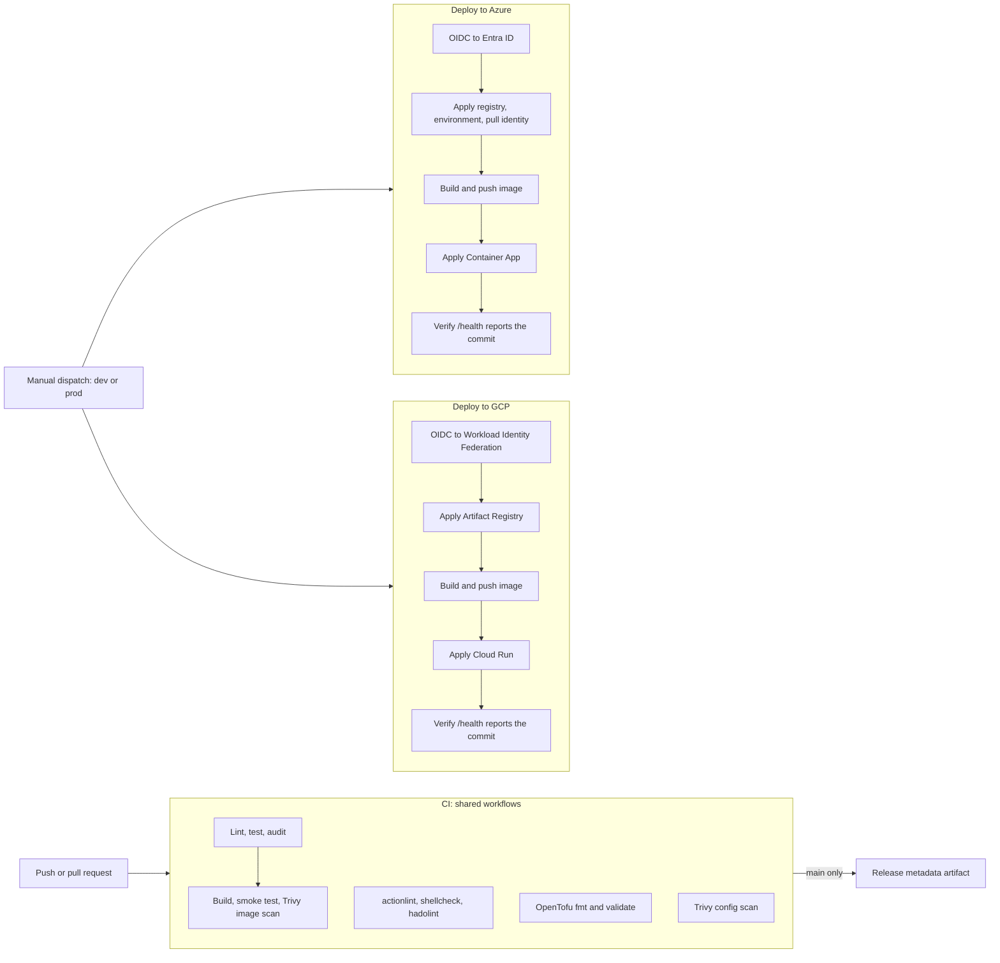

# Architecture

One Flask service, one container image definition, and two deployment targets:
Google Cloud Run and Azure Container Apps. The quality and security gates come
from the shared workflows in
[github-cicd-workflows](https://github.com/Naresh1401/github-cicd-workflows);
this repository's own workflows run the deployments, and OpenTofu owns every
cloud resource the service runs on.

## Components

| Piece | Role |
| --- | --- |
| `app/` | Flask service with `/` and `/health`. `/health` reports the commit it was built from (`APP_VERSION`). |
| `Dockerfile` | Pinned `python:3.11-slim` base, gunicorn, non-root user (UID 10001), healthcheck. |
| `.github/workflows/ci.yml` | Calls the shared quality and security gates from `github-cicd-workflows` on every push and pull request, and sets how strict each one is. |
| `.github/workflows/deploy-*.yml` | Manually dispatched deployments, one per cloud, protected by GitHub Environments. |
| `infra/gcp/` | Artifact Registry, Cloud Run service, public invoker binding. |
| `infra/azure/` | Resource group, Log Analytics, Container Registry, Container Apps environment, user-assigned pull identity with `AcrPull`, Container App. |

## Design decisions

**Identity without secrets.** Both deployments authenticate with the job's
GitHub OIDC token. Azure trusts it through federated credentials scoped to each
GitHub Environment (`repo:<owner>/<repo>:environment:<env>`); GCP trusts it
through a Workload Identity Federation provider limited to this repository. No
cloud key or client secret is stored in GitHub.

**Two-phase apply.** The service cannot be created before its image exists, and
the image cannot be pushed before its registry exists. Each deployment first
applies the registry and platform, pushes the image, then applies everything
else. On Azure, phase one also creates the app's pull identity and its
`AcrPull` grant, so the role has propagated before the first revision pulls.

**Immutable, traceable images.** Images are tagged with the commit SHA, never
`latest`, and the same SHA is baked into the image and set on the service as
`APP_VERSION`. Each deployment ends by polling `/health` until the new revision
reports that SHA, which proves the new code is serving, not just that something
is.

**Remote, per-environment state.** OpenTofu state lives in a versioned GCS
bucket or Azure Storage container, with one state file per cloud and
environment. Those stores are created once by hand so a failed deployment can
never create unmanaged state.

**Gates before images.** The image is only built after lint, tests and the
dependency audit pass, and CI fails on any critical or high vulnerability that
has a fix available, in the image or in the Dockerfile and OpenTofu code.

## Trade-offs and next steps

- Each deployment builds its image from the dispatched commit. Pushing the
  CI-built image to a registry and promoting that exact digest would make every
  environment run byte-identical artifacts.
- Image signing (for example Sigstore cosign with keyless OIDC) and admission
  policies would let each platform refuse unsigned images.
- Canary or blue/green rollouts would use Cloud Run traffic splitting and Azure
  Container Apps multiple-revision mode.
