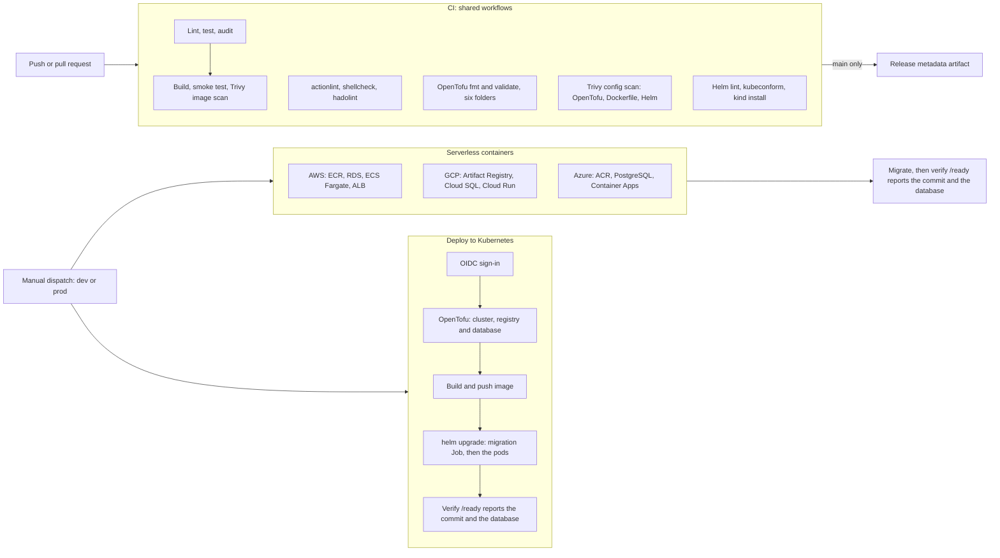

# Architecture

One Flask service backed by PostgreSQL, one container image definition, and six deployment
targets across three clouds: a serverless container platform on each (ECS Fargate, Cloud
Run, Azure Container Apps) and Kubernetes on each (EKS Auto Mode, GKE Autopilot, AKS) through
a single Helm chart. The quality and security gates come from the shared workflows in
[github-cicd-workflows](https://github.com/Naresh1401/github-cicd-workflows); this
repository's own workflows run the deployments, and OpenTofu owns every cloud resource
the service runs on.

## Components

| Piece | Role |
| --- | --- |
| `app/` | Flask service with `/`, `/health`, `/ready` and `/api/items`. `/health` reports the commit it was built from (`APP_VERSION`); `/ready` also checks the database. `app/db.py` connects to PostgreSQL with each cloud's sign-in, and `python -m app.migrate` applies the migrations in `app/migrations` ([database.md](database.md)). |
| `Dockerfile` | Pinned `python:3.11-slim` base, gunicorn, non-root user (UID 10001), healthcheck. |
| `deploy/helm/multi-cloud-app/` | Helm chart for any cluster, with `values-gke.yaml`, `values-aks.yaml` and `values-eks.yaml` for each cloud's load balancer and database sign-in, and a migration Job that runs as a hook before every upgrade. |
| `deploy/kind/` | A throwaway PostgreSQL that CI (and `values-kind.yaml`) installs the chart against on kind. |
| `.github/workflows/ci.yml` | Calls the shared quality and security gates on every push and pull request, including a kind install of the chart, and sets how strict each one is. |
| `.github/workflows/deploy-aws.yml`, `deploy-gcp.yml`, `deploy-azure.yml` | Manually dispatched serverless deployments, one per cloud, protected by GitHub Environments. |
| `.github/workflows/deploy-kubernetes.yml` | Manually dispatched Kubernetes deployment to GKE, AKS or EKS. |
| `infra/aws/` | VPC with NAT and database subnets, ECR, RDS, ECS cluster, Fargate service in private subnets whose tasks migrate the database first, Application Load Balancer (HTTPS when a certificate is set). |
| `infra/gcp/` | Artifact Registry, a VPC for Direct VPC egress, Cloud SQL, service accounts for the service and the migration job, the migration job, Cloud Run service, public invoker binding. |
| `infra/azure/` | Resource group, virtual network, Log Analytics, Container Registry, PostgreSQL flexible server, Container Apps environment in the network, managed identities for the app and the migration job, the migration job, Container App. |
| `infra/eks/` | VPC across three zones with database subnets, EKS Auto Mode cluster, ECR, RDS, and Pod Identity roles for the service and the migration Job. |
| `infra/gke/` | VPC with pod and service ranges, Cloud NAT, GKE Autopilot cluster with private nodes, Artifact Registry, Cloud SQL, and Workload Identity bindings for the service and the migration Job. |
| `infra/aks/` | Resource group, virtual network, Container Registry, AKS cluster with Cilium networking and workload identity, a PostgreSQL flexible server, and federated managed identities for the service and the migration Job. |
| `infra/modules/` | The PostgreSQL setup for each cloud (`aws-database`, `gcp-database`, `azure-database`), shared by its targets. |

## Design decisions

**Identity without secrets.** Every deployment authenticates with the job's GitHub
OIDC token. AWS trusts it through an IAM role limited to this repository's
environments, Azure through federated credentials scoped to each GitHub Environment
(`repo:<owner>/<repo>:environment:<env>`), and GCP through a Workload Identity
Federation provider limited to this repository. No cloud key or client secret is
stored in GitHub.

**Databases without passwords.** The service signs in to PostgreSQL with its platform's
identity: RDS IAM tokens, Cloud SQL IAM through the Cloud SQL connector, or Microsoft Entra
tokens. Each token lives an hour or less and is fetched per connection. Migrations run as a
separate Job with a separate identity, the only one that can change the schema; the
service's role can read and write rows and nothing more. On Google Cloud and Azure no
database password exists at all; on AWS the administrator's password is generated, stored
and rotated by RDS in Secrets Manager, and only the migration Job may read it. Every
database is reachable only from its own network, over TLS that verifies the server.

**One image, six platforms.** Every target runs the same Dockerfile, tagged with the
commit SHA and built with that SHA baked in as `APP_VERSION`. Each deployment ends by
polling `/ready` until the new code reports that SHA and a working database, which proves
the new code is serving, not just that something is.

**Registry first, then the service.** A service cannot be created before its image
exists, and the image cannot be pushed before its registry exists. The serverless
deployments apply the registry (and platform) first, push the image, then apply the
rest. Kubernetes creates the cluster and registry together, then installs the chart.

**One chart, cloud-specific values.** The chart holds everything that is the same on
every cluster: security settings, probes, autoscaling, the disruption budget and the
network policy. Each cloud's values file only changes the Service, so the three
clusters run identical pods.

**Clusters the clouds run.** GKE Autopilot and EKS Auto Mode manage the nodes; AKS uses
an autoscaling system pool with automatic upgrades. Nobody patches nodes by hand.

**Kubernetes tested before any cloud.** CI installs the chart on a kind cluster with the
image built from the commit and checks the commit it reports, so a broken chart fails
the pull request rather than a deployment.

**Remote, per-environment state.** OpenTofu state lives in a versioned S3 bucket, GCS
bucket or Azure Storage container, with one state file per target and environment.
Those stores are created once by hand so a failed deployment can never create unmanaged
state.

**Gates before images.** The image is only built after lint, tests and the dependency
audit pass, and CI fails on any critical or high vulnerability that has a fix
available, in the image or in the Dockerfile, OpenTofu and Helm code. The few accepted
exceptions (a public load balancer, plain HTTP until a certificate is set, a public
Kubernetes API endpoint for GitHub-hosted runners) are marked in the code with the reason.

## Trade-offs and next steps

- Each deployment builds its image from the dispatched commit. Pushing the CI-built
  image to a registry and promoting that exact digest would make every environment run
  byte-identical artifacts.
- Image signing (for example Sigstore cosign with keyless OIDC) and admission policies
  would let each platform refuse unsigned images.
- The Kubernetes API endpoints are public because GitHub-hosted runners have no fixed
  address; self-hosted runners inside each network would allow private endpoints.
- The ECS load balancer serves plain HTTP until `AWS_CERTIFICATE_ARN` is set, and the
  Kubernetes load balancers serve plain HTTP until an Ingress with TLS is added.
- kind proves the chart, the migration hook and the database flow, not each cloud's load
  balancer or identity integration; those are verified by the deployment's own `/ready` check.
- Each deployment target has its own database. Targets that should share data would share
  one database per cloud, with network peering between them.
- On GKE and AKS the pods may open HTTPS connections to any address, because the identity
  and Cloud SQL Admin endpoints have no fixed ranges; an egress gateway or FQDN policies
  would narrow that.
- Canary or blue/green rollouts would use Cloud Run traffic splitting, Container Apps
  multiple-revision mode, ECS blue/green deployments, or Argo Rollouts on Kubernetes.
