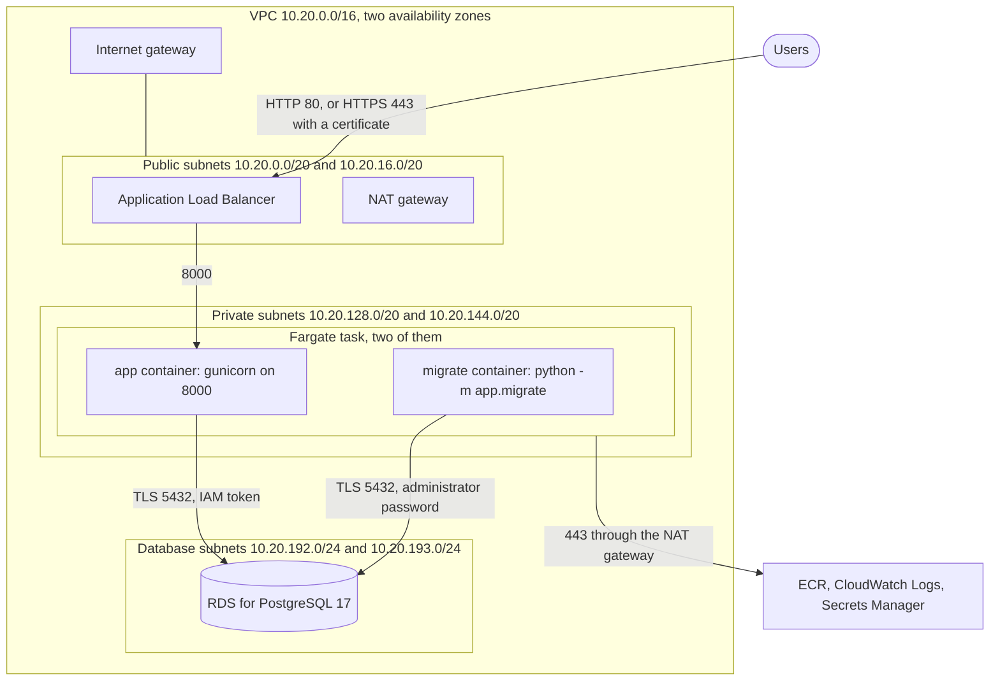
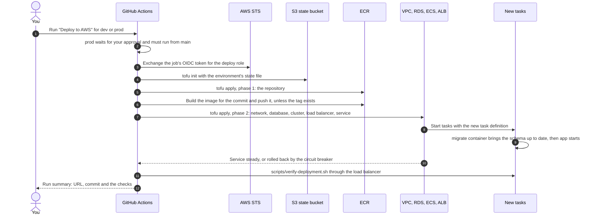
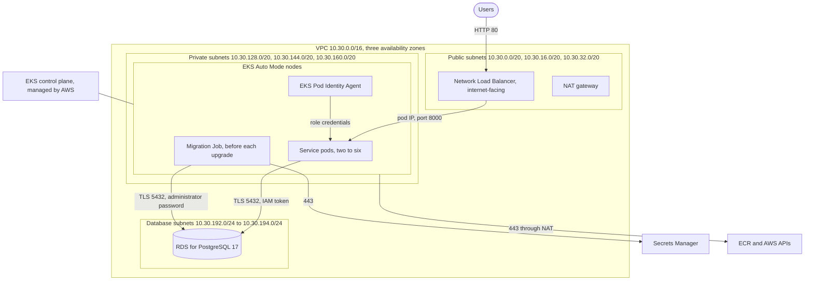
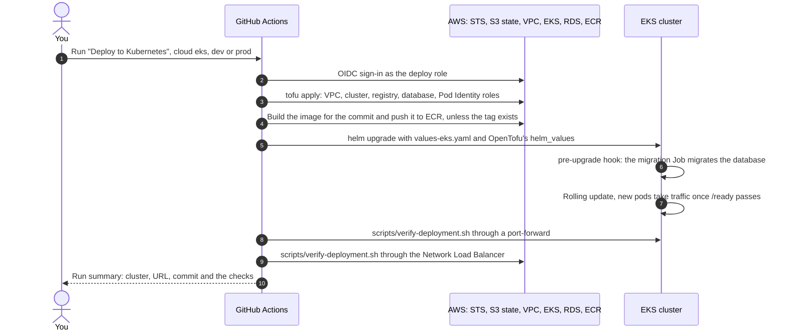

# AWS architecture

The service runs on AWS in two ways, each a separate OpenTofu folder with its own VPC, registry
and PostgreSQL database:

| | ECS Fargate | EKS Auto Mode |
| --- | --- | --- |
| OpenTofu folder | [`infra/aws`](../infra/aws) | [`infra/eks`](../infra/eks) |
| Deploy workflow | **Deploy to AWS** ([deploy-aws.yml](../.github/workflows/deploy-aws.yml)) | **Deploy to Kubernetes**, cloud `eks` ([deploy-kubernetes.yml](../.github/workflows/deploy-kubernetes.yml)) |
| Names (environment `dev`) | `multi-cloud-app-dev` (`<AWS_SERVICE_NAME>-<environment>`) | `multi-cloud-dev` (`<cluster_name>-<environment>`) |
| Network | VPC `10.20.0.0/16` in 2 availability zones | VPC `10.30.0.0/16` in 3 availability zones |
| Runs the containers | Fargate tasks in private subnets | Pods on EKS Auto Mode nodes in private subnets |
| Takes traffic | Application Load Balancer | Network Load Balancer, created for the chart's Service |
| Registry | ECR `multi-cloud-app-dev` | ECR `multi-cloud-dev-app` |
| Database | RDS for PostgreSQL 17 in database subnets | RDS for PostgreSQL 17 in database subnets |
| Service signs in with | RDS IAM token, from the task role | RDS IAM token, from an EKS Pod Identity role |
| Migrations | A `migrate` container in every task, before the app container | A Helm hook Job before every install and upgrade |
| Logs | CloudWatch Logs `/ecs/multi-cloud-app-dev` | CloudWatch Logs (control plane) |

The one-time account setup (state bucket, GitHub OIDC role) is in the
[AWS deployment guide](aws-deployment.md), the chart in
[kubernetes-architecture.md](kubernetes-architecture.md), and the database code in
[database.md](database.md).

- [ECS Fargate](#ecs-fargate)
  - [Request path](#ecs-request-path) · [Network](#ecs-network) · [Security groups](#ecs-security-groups) · [Compute](#ecs-compute) · [Registry](#ecs-registry) · [Database](#ecs-database) · [Encryption](#ecs-encryption) · [Identity and access](#ecs-identity-and-access) · [Logs and metrics](#ecs-logs-and-metrics) · [Every resource](#ecs-every-resource) · [Deployment flow](#ecs-deployment-flow) · [Verify a deployment](#ecs-verify-a-deployment)
- [EKS Auto Mode](#eks-auto-mode)
  - [Request path](#eks-request-path) · [Network](#eks-network) · [Cluster](#eks-cluster) · [Pod identities](#eks-pod-identities) · [Database](#eks-database) · [Encryption](#eks-encryption) · [Logs and metrics](#eks-logs-and-metrics) · [Every resource](#eks-every-resource) · [Deployment flow](#eks-deployment-flow) · [Verify a deployment](#eks-verify-a-deployment)
- [Check it without an AWS account](#check-it-without-an-aws-account)
- [Not included](#not-included)

## ECS Fargate



<a id="ecs-request-path"></a>

### Request path

1. A user reaches the load balancer's public DNS name on port 80, or 443 once
   `AWS_CERTIFICATE_ARN` is set; port 80 then redirects to HTTPS.
2. The load balancer forwards to a healthy task's IP on port 8000. It only sends traffic to
   tasks whose `/health` answered 200 twice in a row (checked every 15 seconds).
3. gunicorn (two worker processes, four threads each) hands the request to Flask.
4. A request that needs the database takes a connection from its worker's pool. A new connection
   signs in as `app_user` with an RDS IAM token that the AWS SDK signs locally with the task
   role's credentials, over TLS that verifies the server against the RDS certificate authority.
5. The response leaves with the security headers set.

<a id="ecs-network"></a>

### Network

The VPC comes from the community module `terraform-aws-modules/vpc` (`module.vpc`).

| Subnet | CIDR blocks | Route table | What lives there |
| --- | --- | --- | --- |
| Public | `10.20.0.0/20`, `10.20.16.0/20` | `multi-cloud-app-dev-public`: `0.0.0.0/0` to the internet gateway | Load balancer, NAT gateway |
| Private | `10.20.128.0/20`, `10.20.144.0/20` | `multi-cloud-app-dev-private`: `0.0.0.0/0` to the NAT gateway (in `prod`, one table and one NAT gateway per zone) | Fargate tasks |
| Database | `10.20.192.0/24`, `10.20.193.0/24` | `multi-cloud-app-dev-db` (in `prod`, `multi-cloud-app-prod-db-<zone>` per zone): the VPC only, no route out | RDS |

- **NAT:** one NAT gateway with its own Elastic IP in `dev`; one per availability zone in `prod`,
  so losing a zone doesn't cut the other zone's tasks off from AWS's APIs.
- **Public IPs:** subnets don't hand out public IPs (`map_public_ip_on_launch` is off), and tasks
  get none.
- **Default resources:** the module takes over the VPC's default security group and removes all
  its rules, so nothing can use it by accident. The default network ACL allows all traffic;
  security groups do the filtering. The default route table has only the local route.
- **Flow logs:** every accepted and rejected connection in the VPC, aggregated every 60 seconds,
  goes to CloudWatch Logs group `/aws/vpc-flow-log/<vpc-id>` for 30 days, written by the IAM
  role `vpc-flow-log-role-*`.

<a id="ecs-security-groups"></a>

### Security groups

| Group | Direction | Port | Peer | Why |
| --- | --- | --- | --- | --- |
| `multi-cloud-app-dev-alb` | in | 80 | `0.0.0.0/0` | Public HTTP (a redirect once HTTPS is on) |
| `multi-cloud-app-dev-alb` | in | 443 | `0.0.0.0/0` | Public HTTPS, only when a certificate is set |
| `multi-cloud-app-dev-alb` | out | 8000 | task group | Forward to the tasks |
| `multi-cloud-app-dev-task` | in | 8000 | load balancer group | Only the load balancer reaches the app |
| `multi-cloud-app-dev-task` | out | 443 | `0.0.0.0/0` | ECR, CloudWatch Logs, Secrets Manager, through the NAT gateway |
| `multi-cloud-app-dev-task` | out | 5432 | database group | PostgreSQL |
| `multi-cloud-app-dev-database` | in | 5432 | task group | Only the tasks reach the database |
| `multi-cloud-app-dev-database` | out | none | | The database opens no connections |

<a id="ecs-compute"></a>

### Compute

- **Cluster** `aws_ecs_cluster.app`: `multi-cloud-app-dev`, with Container Insights on.
- **Task definition** `aws_ecs_task_definition.app`, family `multi-cloud-app-dev`: Fargate,
  `awsvpc` networking, 0.25 vCPU and 1 GiB (`task_cpu`, `task_memory`), Linux on x86-64, the
  execution and task roles below, and one task-scoped volume, `tmp`. Two containers, both from the
  image tagged with the deployed commit:

  | Container | Essential | Starts | Runs | Signs in as | Gets |
  | --- | --- | --- | --- | --- | --- |
  | `migrate` | no | first | `python -m app.migrate`, then exits | `dbadmin`, with the password ECS injects from Secrets Manager (`DB_PASSWORD`) | `DB_AUTH=password`, `DB_APP_AUTH=aws-iam`, `DB_APP_ROLE=app_user` |
  | `app` | yes | once `migrate` exited 0 (`dependsOn` `SUCCESS`) | gunicorn on 8000 | `app_user`, with an IAM token | `DB_AUTH=aws-iam`, `APP_VERSION=<commit>` |

  Both get `APP_ENV`, `AWS_REGION`, `DB_HOST`, `DB_PORT` and `DB_NAME`, run as UID 10001 (from the
  image) with a read-only root filesystem, no Linux capabilities and only `/tmp` writable, and log
  to CloudWatch with the stream prefixes `migrate/` and `app/`.
- **Service** `aws_ecs_service.app`: `multi-cloud-app` in the cluster, 2 tasks (`desired_count`)
  spread over the private subnets, no public IPs, registered with the target group on port 8000.
  A deployment starts new tasks before it stops old ones (ECS's defaults of 100% minimum healthy
  and 200% maximum), the circuit breaker rolls back to the previous task definition when new
  tasks keep failing, and OpenTofu waits until the service is steady.
- **Load balancer** `aws_lb.app`: public Application Load Balancer in the public subnets, dropping
  invalid header fields. Target group `aws_lb_target_group.app`: IP targets on 8000, health check
  `GET /health` expecting 200 every 15 seconds (2 passes to join, 3 failures to leave), 30
  seconds' draining. Listeners: `aws_lb_listener.http` on 80, which forwards, or redirects with
  301 when a certificate is set; `aws_lb_listener.https` on 443 with
  `ELBSecurityPolicy-TLS13-1-2-2021-06` (TLS 1.2 and 1.3) when `certificate_arn` is set.

The load balancer checks `/health`, not `/ready`: ECS replaces tasks that fail the load
balancer's check, so checking the database there would restart every task during a database
outage. The `migrate` container already proves each new task reached the database.

<a id="ecs-registry"></a>

### Registry

`aws_ecr_repository.app`, `multi-cloud-app-dev`: immutable tags (each commit SHA is pushed once),
a vulnerability scan on every push, encryption with KMS (the AWS-managed `aws/ecr` key), and
`aws_ecr_lifecycle_policy.app` keeps the 30 newest images. Outside `prod` the repository can be
deleted with its images (`force_delete`).

<a id="ecs-database"></a>

### Database

From [`infra/modules/aws-database`](../infra/modules/aws-database), shared with EKS:

| Setting | Value |
| --- | --- |
| Instance `aws_db_instance.this` | `multi-cloud-app-dev`, PostgreSQL 17 (newest minor version, upgraded automatically in the maintenance window), `db.t4g.micro` (`database_instance_class`) |
| Storage (block storage) | 20 GiB gp3 (`allocated_storage`), growing up to 100 GiB (`max_allocated_storage`); IOPS and throughput sit at gp3's free per-GiB baseline unless `storage_iops`/`storage_throughput` provision more |
| Encryption | AWS's own `aws/rds` key by default; `kms_key_arn` (shared with this target's image repository and container logs, see [Encryption](#ecs-encryption)) encrypts storage and Performance Insights instead. Set once, at creation: changing it later replaces the instance |
| Database and administrator | Database `app`; administrator `dbadmin`, whose password RDS generates, stores in Secrets Manager and rotates (`manage_master_user_password`) |
| Sign-in | IAM database authentication on; `app_user` is a member of `rds_iam`, so RDS accepts only IAM tokens for it |
| Network | Subnet group `aws_db_subnet_group.this` (the database subnets), group `aws_security_group.this`, no public endpoint |
| TLS | Parameter group `aws_db_parameter_group.this` (`postgres17`) sets `rds.force_ssl=1`; the server certificate comes from `rds-ca-rsa2048-g1`, which the app verifies with [app/certs/aws-rds-global-bundle.pem](../app/certs/aws-rds-global-bundle.pem) |
| Logging | `log_connections` and `log_disconnections` on; the `postgresql` and `upgrade` logs go to CloudWatch Logs (`/aws/rds/instance/multi-cloud-app-dev/postgresql`); Performance Insights on |
| Availability | `dev`: one zone. `prod`: Multi-AZ, a standby in the other zone |
| Backups | Daily at 03:00-04:00 UTC, kept 7 days (`prod`: 14), with point-in-time recovery; tags copied to snapshots |
| Maintenance | Sundays 04:30-05:30 UTC; changes apply at once in `dev`, in the window in `prod`; no automatic major upgrades |
| Deletion | `dev`: deletable, no final snapshot. `prod`: deletion protection, final snapshot `multi-cloud-app-prod-final` |

The migrate container creates `app_user` (`CREATE ROLE app_user LOGIN; GRANT rds_iam TO app_user`)
and grants it read and write access to the `app` schema's tables; see
[database.md](database.md#migrations).

<a id="ecs-encryption"></a>

### Encryption

AWS's own keys (`aws/rds`, `aws/ecr`, `aws/logs`) encrypt the database, the image repository and
container logs by default. `enable_customer_managed_key` creates one KMS key, `aws_kms_key.this`
(alias `aws_kms_alias.this`), that all three use instead: the database's storage and Performance
Insights (`kms_key_arn`, passed to the module), the repository's images
(`aws_ecr_repository.app.encryption_configuration.kms_key`) and the container logs
(`aws_cloudwatch_log_group.app.kms_key_id`). The key's policy grants the account root full
access and CloudWatch Logs a grant scoped to this account's log groups; the repository and the
database instead use grants OpenTofu's own credentials create, which the root statement covers.

The log group can move to the key, or back to AWS's own, at any time. The repository and the
database can't: enabling this after either already exists forces OpenTofu to replace it, since
neither can re-encrypt existing images or storage with a different key. Set it before the first
apply.

<a id="ecs-identity-and-access"></a>

### Identity and access

| Identity | Created by | Can | Used by |
| --- | --- | --- | --- |
| GitHub deploy role (`AWS_ROLE_ARN`) | You, once ([guide](aws-deployment.md)) | Everything OpenTofu creates here, and the state bucket; trusts only this repository's `dev` and `prod` environments through GitHub OIDC | The deploy workflow |
| `multi-cloud-app-dev-execution` (`aws_iam_role.execution`) | OpenTofu | Pull from ECR and write logs (`aws_iam_role_policy_attachment.execution`: `AmazonECSTaskExecutionRolePolicy`), read the administrator's secret (`aws_iam_role_policy.execution_admin_secret`) | ECS itself, while it starts a task; it hands the secret to the `migrate` container only |
| `multi-cloud-app-dev-task` (`aws_iam_role.task`) | OpenTofu | `rds-db:connect` as `app_user` on this instance only (`aws_iam_role_policy.task_database`) | Both containers; the app signs its database tokens with it |
| `vpc-flow-log-role-*` | OpenTofu (VPC module) | Write the VPC's flow logs | VPC Flow Logs |
| RDS's administrator secret | RDS | | ECS, for the `migrate` container |

Both task roles are assumed through the trust policy `data.aws_iam_policy_document.ecs_tasks_assume`
(only `ecs-tasks.amazonaws.com`). The app container can't read the administrator's secret: it is
injected into the `migrate` container's environment by ECS, and the task role has no access to
Secrets Manager.

<a id="ecs-logs-and-metrics"></a>

### Logs and metrics

| What | Where | Kept |
| --- | --- | --- |
| Container output: requests (gunicorn access log), app logs, migrations | CloudWatch Logs `/ecs/multi-cloud-app-dev` (`aws_cloudwatch_log_group.app`), streams `app/app/<task>` and `migrate/migrate/<task>` | 30 days |
| Task and service metrics (CPU, memory, network) | CloudWatch Container Insights | CloudWatch's defaults |
| Load balancer metrics (requests, 5xx, target health) | CloudWatch, namespace `AWS/ApplicationELB` | CloudWatch's defaults |
| PostgreSQL log, upgrade log | CloudWatch Logs `/aws/rds/instance/multi-cloud-app-dev/*` | CloudWatch's defaults |
| Query performance | RDS Performance Insights | 7 days |
| Network flows | CloudWatch Logs `/aws/vpc-flow-log/<vpc-id>` | 30 days |

Alarms (`aws_cloudwatch_metric_alarm.ecs_cpu`, `.ecs_memory`, `.alb_5xx`, `.alb_latency`,
`.alb_unhealthy_hosts`, and the database's own `module.database.aws_cloudwatch_metric_alarm.cpu`,
`.storage`, `.connections`) watch the task and load balancer metrics above. `aws_cloudwatch_dashboard.app`
puts the service, load balancer and database side by side in one CloudWatch dashboard. `ALERT_EMAIL`
(the `alert_email` variable), when set, creates `module.database.aws_sns_topic.alerts` and an email
subscription (`aws_sns_topic_subscription.alerts_email`) every alarm here notifies; `prod` also
subscribes it to the database's failover events (`module.database.aws_db_event_subscription.failover`).
Empty leaves every alarm visible in the console with no one notified. `make inventory` doesn't plan
these (they have no OpenTofu test), but `tofu plan` shows them like anything else.

<a id="ecs-every-resource"></a>

### Every resource

What one `tofu apply` in `infra/aws` creates for `dev`, as `scripts/inventory.sh aws` lists it. In
`prod` the private and database route tables, NAT gateway, Elastic IP and NAT route exist once per
zone; with a certificate, the HTTPS listener and its ingress rule are added.

| Resource | What it is |
| --- | --- |
| `module.vpc.aws_vpc.this[0]` | The VPC, `10.20.0.0/16`, with DNS support and hostnames |
| `module.vpc.aws_subnet.public[0..1]` | Public subnets |
| `module.vpc.aws_subnet.private[0..1]` | Private subnets for the tasks |
| `module.vpc.aws_subnet.database[0..1]` | Database subnets |
| `module.vpc.aws_internet_gateway.this[0]` | Internet gateway for the public subnets |
| `module.vpc.aws_eip.nat[0]` | The NAT gateway's public IP |
| `module.vpc.aws_nat_gateway.this[0]` | NAT gateway, so private subnets reach AWS's APIs |
| `module.vpc.aws_route_table.public[0]` | Public route table |
| `module.vpc.aws_route.public_internet_gateway[0]` | `0.0.0.0/0` to the internet gateway |
| `module.vpc.aws_route_table.private[0]` | Private route table |
| `module.vpc.aws_route.private_nat_gateway[0]` | `0.0.0.0/0` to the NAT gateway |
| `module.vpc.aws_route_table.database[0]` | Database route table, with no route out |
| `module.vpc.aws_route_table_association.public[0..1]` | Public subnets to their table |
| `module.vpc.aws_route_table_association.private[0..1]` | Private subnets to their table |
| `module.vpc.aws_route_table_association.database[0..1]` | Database subnets to their table |
| `module.vpc.aws_default_security_group.this[0]` | The default security group, emptied |
| `module.vpc.aws_default_network_acl.this[0]` | The default network ACL |
| `module.vpc.aws_default_route_table.default[0]` | The default route table |
| `module.vpc.aws_flow_log.this[0]` | VPC flow logs |
| `module.vpc.aws_cloudwatch_log_group.flow_log[0]` | Their log group |
| `module.vpc.aws_iam_role.vpc_flow_log_cloudwatch[0]` | The role that writes them |
| `module.vpc.aws_iam_policy.vpc_flow_log_cloudwatch[0]` | Its permission to write |
| `module.vpc.aws_iam_role_policy_attachment.vpc_flow_log_cloudwatch[0]` | Attaches it |
| `aws_security_group.alb` | Load balancer group |
| `aws_security_group.task` | Task group |
| `aws_vpc_security_group_ingress_rule.alb_http` | 80 from anywhere |
| `aws_vpc_security_group_ingress_rule.alb_https` | 443 from anywhere, with a certificate |
| `aws_vpc_security_group_egress_rule.alb_to_tasks` | Load balancer to tasks on 8000 |
| `aws_vpc_security_group_ingress_rule.task_from_alb` | Tasks take 8000 from the load balancer |
| `aws_vpc_security_group_egress_rule.task_https` | Tasks out on 443 |
| `aws_vpc_security_group_egress_rule.task_database` | Tasks out to the database on 5432 |
| `aws_kms_key.this` | With `enable_customer_managed_key`: encrypts the repository, logs and database |
| `aws_kms_alias.this` | `alias/multi-cloud-app-dev` |
| `aws_ecr_repository.app` | Image repository |
| `aws_ecr_lifecycle_policy.app` | Keeps the 30 newest images |
| `aws_ecs_cluster.app` | ECS cluster |
| `aws_cloudwatch_log_group.app` | Container logs |
| `aws_iam_role.execution` | ECS's role for starting tasks |
| `aws_iam_role_policy_attachment.execution` | `AmazonECSTaskExecutionRolePolicy` |
| `aws_iam_role_policy.execution_admin_secret` | Read the administrator's secret |
| `aws_iam_role.task` | The containers' role |
| `aws_iam_role_policy.task_database` | Connect as `app_user` |
| `aws_ecs_task_definition.app` | The two containers |
| `aws_lb.app` | Application Load Balancer |
| `aws_lb_target_group.app` | The tasks behind it |
| `aws_lb_listener.http` | Port 80 |
| `aws_lb_listener.https` | Port 443, with a certificate |
| `aws_ecs_service.app` | Runs and replaces the tasks |
| `aws_cloudwatch_metric_alarm.ecs_cpu` | Task CPU above 80% for 15 minutes |
| `aws_cloudwatch_metric_alarm.ecs_memory` | Task memory above 80% for 15 minutes |
| `aws_cloudwatch_metric_alarm.alb_5xx` | More than 10 server errors in 5 minutes |
| `aws_cloudwatch_metric_alarm.alb_latency` | p99 target response time above 1s for 15 minutes |
| `aws_cloudwatch_metric_alarm.alb_unhealthy_hosts` | Any unhealthy task behind the load balancer |
| `aws_cloudwatch_dashboard.app` | Service, load balancer and database metrics together |
| `module.database.aws_db_subnet_group.this` | Database subnets for RDS |
| `module.database.aws_security_group.this` | Database group |
| `module.database.aws_vpc_security_group_ingress_rule.from_security_groups[0]` | 5432 from the tasks |
| `module.database.aws_db_parameter_group.this` | TLS-only and connection logging |
| `module.database.aws_db_instance.this` | The PostgreSQL instance |
| `module.database.aws_cloudwatch_metric_alarm.cpu` | Database CPU above 80% for 15 minutes |
| `module.database.aws_cloudwatch_metric_alarm.storage` | Database free storage below 10% |
| `module.database.aws_cloudwatch_metric_alarm.connections` | More than 80 open connections for 15 minutes |
| `module.database.aws_sns_topic.alerts` | Where the alarms notify, with `alert_email` set |
| `module.database.aws_sns_topic_subscription.alerts_email` | The email subscription on it |
| `module.database.aws_db_event_subscription.failover` | `prod` with `alert_email` set: notifies on a Multi-AZ failover |

Data sources it reads: `data.aws_availability_zones.available` (the first two zones),
`data.aws_iam_policy_document.ecs_tasks_assume`, and in the module `data.aws_partition.current`,
`data.aws_region.current`, `data.aws_caller_identity.current`,
`data.aws_iam_policy_document.connect` (the `rds-db:connect` policy) and
`data.aws_iam_policy_document.admin_secret` (the secret-read policy). The module also declares
`aws_vpc_security_group_ingress_rule.from_cidrs`, which ECS doesn't use: it allows address ranges
instead of security groups, as EKS needs.

<a id="ecs-deployment-flow"></a>

### Deployment flow



| # | Step in [deploy-aws.yml](../.github/workflows/deploy-aws.yml) | What happens | How to check it |
| --- | --- | --- | --- |
| 1 | Allow production deployments only from main | Stops a `prod` run from any branch but `main`. The `prod` environment also waits for your approval before the job starts. | A run from another branch fails here; approve `prod` runs under **Review deployments**. |
| 2 | `actions/checkout` | Checks out the commit being deployed. | The step log shows the commit. |
| 3 | Check required configuration | Fails fast if `AWS_REGION`, `AWS_SERVICE_NAME`, `AWS_TF_STATE_BUCKET` or the `AWS_ROLE_ARN` secret is missing from the environment. | The error names the missing setting. |
| 4 | Export OpenTofu variables | Passes the environment, region, service name, certificate and commit SHA to OpenTofu as `TF_VAR_*`. | The step log lists the variable names. |
| 5 | Authenticate to AWS | Exchanges the job's OIDC token for temporary credentials as the deploy role; no AWS key is stored in GitHub. | `AccessDenied` here means the role's trust policy doesn't match `repo:<owner>/<repo>:environment:<env>`. |
| 6 | `opentofu/setup-opentofu` | Installs OpenTofu. | |
| 7 | Initialize OpenTofu state | `tofu init` with state at `s3://<AWS_TF_STATE_BUCKET>/<AWS_SERVICE_NAME>/<environment>/ecs.tfstate`, locked with a lock file in the bucket. | `aws s3 ls s3://<bucket>/<service>/<environment>/` lists the state file. |
| 8 | Provision ECR | Phase 1: applies only the repository and its lifecycle policy, so the image can be pushed before the service exists. | `aws ecr describe-repositories --repository-names multi-cloud-app-dev` |
| 9 | Log in to ECR | Logs Docker in to the registry. | |
| 10 | Build and push image | Builds the image with the commit SHA as its tag and its `APP_VERSION`, and pushes it; a re-run for the same commit reuses the image, since tags are immutable. | `aws ecr describe-images --repository-name multi-cloud-app-dev --image-ids imageTag=<sha>` shows the image and its scan. |
| 11 | Deploy the ECS service | Phase 2: applies everything else (network, database, roles, task definition, load balancer, service) and waits until the service is steady. Each new task runs its `migrate` container first; if migrations fail, the app container never starts, the circuit breaker rolls back and the apply fails. | The plan in the log; **ECS > Clusters > multi-cloud-app-dev > Deployments**; the `migrate/` log streams. The first run takes 10 minutes or more while RDS is created. |
| 12 | Verify the deployment end to end | Runs [scripts/verify-deployment.sh](../scripts/verify-deployment.sh) against the load balancer: the commit serves, the database answers, headers and errors are right, the items API reads (and in `dev` writes). Sets the environment's URL. | The run summary's table; run the same script yourself. |

<a id="ecs-verify-a-deployment"></a>

### Verify a deployment

```bash
NAME=multi-cloud-app-dev            # <AWS_SERVICE_NAME>-<environment>
URL=http://<load balancer DNS name> # from the run summary or: tofu output -raw service_url
scripts/verify-deployment.sh "$URL" <commit SHA>

# Two tasks running the newest task definition, rollout complete
aws ecs describe-services --cluster "$NAME" --services multi-cloud-app \
  --query 'services[0].{desired:desiredCount,running:runningCount,rollout:deployments[0].rolloutState,taskDefinition:taskDefinition}'

# Both containers read-only, app waiting for migrate
aws ecs describe-task-definition --task-definition "$NAME" \
  --query 'taskDefinition.containerDefinitions[].{name:name,essential:essential,readOnly:readonlyRootFilesystem,dependsOn:dependsOn}'

# Both targets healthy
aws elbv2 describe-target-health --query 'TargetHealthDescriptions[].TargetHealth.State' \
  --target-group-arn "$(aws elbv2 describe-target-groups --names "$NAME" --query 'TargetGroups[0].TargetGroupArn' --output text)"

# Private, encrypted, IAM sign-in, PostgreSQL 17, administrator secret managed by RDS
aws rds describe-db-instances --db-instance-identifier "$NAME" --query 'DBInstances[0].{public:PubliclyAccessible,encrypted:StorageEncrypted,iamAuth:IAMDatabaseAuthenticationEnabled,multiAZ:MultiAZ,version:EngineVersion,ca:CACertificateIdentifier,secret:MasterUserSecret.SecretStatus}'

# The migrations' output, and the app's
aws logs tail "/ecs/$NAME" --since 1h --log-stream-name-prefix migrate/
aws logs tail "/ecs/$NAME" --since 10m --log-stream-name-prefix app/

# The database subnets route only inside the VPC
aws ec2 describe-route-tables --filters "Name=tag:Name,Values=$NAME-db*" --query 'RouteTables[].Routes[].[DestinationCidrBlock,GatewayId]'

# Flow logs on, all traffic
aws ec2 describe-flow-logs --query 'FlowLogs[].{vpc:ResourceId,traffic:TrafficType,group:LogGroupName}'
```

Expect `running` 2 and `rollout` `COMPLETED`; `readOnly` true and `dependsOn` `migrate`/`SUCCESS`
for `app`; two `healthy` targets; `public` false, `encrypted` true, `iamAuth` true, a `17.x`
version and secret status `active`; a `Database ... is at revision ...` line in the migrate log;
and only the `local` route for the database subnets.

## EKS Auto Mode



<a id="eks-request-path"></a>

### Request path

1. A user reaches the Network Load Balancer's DNS name on port 80. EKS Auto Mode creates it for
   the chart's `LoadBalancer` Service (`values-eks.yaml`: class `eks.amazonaws.com/nlb`,
   internet-facing, targets are pod IPs, health check `/health`).
2. The load balancer sends the connection straight to a ready pod's IP on port 8000; pods only
   count as ready once `/ready` reached the database.
3. The pod signs in to RDS as `app_user` with an IAM token, signed with credentials the EKS Pod
   Identity Agent on its node hands out for the role `multi-cloud-dev-app`.

<a id="eks-network"></a>

### Network

| Subnet | CIDR blocks | Route table | Tags | What lives there |
| --- | --- | --- | --- | --- |
| Public | `10.30.0.0/20`, `10.30.16.0/20`, `10.30.32.0/20` | `0.0.0.0/0` to the internet gateway | `kubernetes.io/role/elb=1` | Internet-facing load balancers, NAT gateway |
| Private | `10.30.128.0/20`, `10.30.144.0/20`, `10.30.160.0/20` | `0.0.0.0/0` to the NAT gateway (one per zone in `prod`) | `kubernetes.io/role/internal-elb=1` | Nodes and pods, internal load balancers |
| Database | `10.30.192.0/24`, `10.30.193.0/24`, `10.30.194.0/24` | The VPC only (`multi-cloud-dev-db`; one per zone in `prod`) | | RDS |

Like ECS's VPC: one NAT gateway in `dev`, one per zone in `prod`; no public IPs on launch; the
default security group emptied; flow logs to `/aws/vpc-flow-log/<vpc-id>` for 30 days. Pods get
VPC addresses from the private subnets, so the database accepts PostgreSQL from those three
ranges.

<a id="eks-cluster"></a>

### Cluster

From the community module `terraform-aws-modules/eks` (`module.eks`):

- **EKS Auto Mode** with the built-in `general-purpose` and `system` node pools: AWS launches,
  patches and replaces the nodes and runs the load balancer, storage and network controllers.
  The nodes run in the private subnets and use the cluster security group that EKS creates
  itself; the module's own cluster and node groups are turned off, since they only serve managed
  node groups. Self-managed add-ons aren't bootstrapped.
- **Kubernetes API**: public endpoint, open to `api_allowed_cidrs` (default anywhere, because
  GitHub-hosted runners have no fixed address), plus a private endpoint inside the VPC. Access
  is managed with EKS access entries (`API_AND_CONFIG_MAP`); the identity that runs OpenTofu, the
  deploy role, gets `AmazonEKSClusterAdminPolicy` through the access entry `cluster_creator`.
- **Encryption**: Kubernetes secrets are encrypted with a customer-managed KMS key, alias
  `eks/multi-cloud-dev`, that the cluster role uses and the deploy role administers.
- **Control plane logs**: `api`, `audit` and `authenticator`, to CloudWatch Logs
  `/aws/eks/multi-cloud-dev/cluster` for 90 days.
- **IAM roles**: the cluster role `multi-cloud-dev-cluster-*`, with `AmazonEKSClusterPolicy`,
  `AmazonEKSComputePolicy`, `AmazonEKSBlockStoragePolicy`, `AmazonEKSLoadBalancingPolicy` and
  `AmazonEKSNetworkingPolicy`, plus two policies of the module's own: one to use the KMS key and
  one that lets Auto Mode put the cluster's tags on what it creates. The node role
  `multi-cloud-dev-eks-auto-*` with `AmazonEKSWorkerNodeMinimalPolicy` and
  `AmazonEC2ContainerRegistryPullOnly`. Pods get no credentials from the node role: their AWS
  access comes from Pod Identity.
- **No IRSA**: no IAM OIDC provider is created, because Pod Identity replaces it.
- After creating the cluster the module waits 30 seconds (`time_sleep`) so the data plane is
  ready before anything uses it.

The chart's objects in the cluster (Deployment, Service, migration Job, network policies) are in
[kubernetes-architecture.md](kubernetes-architecture.md).

<a id="eks-pod-identities"></a>

### Pod identities

| Kubernetes service account | IAM role | Can | Resources |
| --- | --- | --- | --- |
| `multi-cloud-app/multi-cloud-app` (the service) | `multi-cloud-dev-app` | `rds-db:connect` as `app_user` only | `aws_iam_role.app`, `aws_iam_role_policy.app_database`, `aws_eks_pod_identity_association.app` |
| `multi-cloud-app/multi-cloud-app-migrate` (the migration Job) | `multi-cloud-dev-migrate` | Read the RDS administrator's secret only | `aws_iam_role.migration`, `aws_iam_role_policy.migration_secret`, `aws_eks_pod_identity_association.migration` |

Both roles trust only `pods.eks.amazonaws.com` (`sts:AssumeRole` and `sts:TagSession`), through
`data.aws_iam_policy_document.pod_identity_assume`. The agent that hands out their credentials
is built into EKS Auto Mode and answers on `169.254.170.23:80`, which the chart's network policy
allows.

<a id="eks-database"></a>

### Database

The same module and settings as [ECS's database](#ecs-database), named `multi-cloud-dev`, with
one difference: its security group takes PostgreSQL from the three private subnets' address
ranges (`aws_vpc_security_group_ingress_rule.from_cidrs`), because pods use VPC addresses rather
than a security group of their own. The migration Job reads the administrator's password from
Secrets Manager itself (`DB_PASSWORD_SECRET_ARN`) with its Pod Identity role; OpenTofu passes the
address, the secret's ARN and the subnets to the chart through the `helm_values` output.

<a id="eks-encryption"></a>

### Encryption

Separate from `module.eks`'s own key, which only encrypts Kubernetes secrets,
`enable_customer_managed_key` creates one KMS key, `aws_kms_key.this` (alias `aws_kms_alias.this`),
for this target's image repository and database: the same pattern as [ECS's](#ecs-encryption),
without the container logs (EKS keeps none of its own; see [Logs and metrics](#eks-logs-and-metrics)).
Enabling it after the repository or the database already exist forces OpenTofu to replace them.

<a id="eks-logs-and-metrics"></a>

### Logs and metrics

Unlike ECS, EKS publishes nothing to CloudWatch on its own beyond the control plane logs
(`module.eks.aws_cloudwatch_log_group.this[0]`). Pod and node metrics need the
`amazon-cloudwatch-observability` add-on (`aws_eks_addon.observability`), which runs as the
`cloudwatch-agent` service account in the `amazon-cloudwatch` namespace, authenticated through
its own Pod Identity role (`aws_iam_role.observability`, `aws_iam_role_policy_attachment.observability`:
`CloudWatchAgentServerPolicy`, `aws_eks_pod_identity_association.observability`) rather than a
hand-installed agent or static credentials.

Once it's running, its metrics land in the `ContainerInsights` namespace, where
`aws_cloudwatch_metric_alarm.node_cpu` (node CPU above 80% for 15 minutes) and `.pod_restarts`
(more than 5 container restarts in 15 minutes) watch them, alongside the database's own
`module.database.aws_cloudwatch_metric_alarm.cpu`, `.storage` and `.connections`.
`aws_cloudwatch_dashboard.app` puts the cluster and database metrics side by side. `alert_email`
wires every alarm here to the same SNS topic as [ECS's](#ecs-logs-and-metrics)
(`module.database.aws_sns_topic.alerts`); empty leaves them visible in the console only.

<a id="eks-every-resource"></a>

### Every resource

What one `tofu apply` in `infra/eks` creates for `dev`, as `scripts/inventory.sh eks` lists it
(in `prod`, a NAT gateway, Elastic IP, NAT route and private and database route tables per zone):

| Resource | What it is |
| --- | --- |
| `module.vpc.aws_vpc.this[0]` | The VPC, `10.30.0.0/16` |
| `module.vpc.aws_subnet.public[0..2]` | Public subnets |
| `module.vpc.aws_subnet.private[0..2]` | Private subnets for nodes and pods |
| `module.vpc.aws_subnet.database[0..2]` | Database subnets |
| `module.vpc.aws_internet_gateway.this[0]` | Internet gateway |
| `module.vpc.aws_eip.nat[0]` | The NAT gateway's public IP |
| `module.vpc.aws_nat_gateway.this[0]` | NAT gateway |
| `module.vpc.aws_route_table.public[0]` | Public route table |
| `module.vpc.aws_route.public_internet_gateway[0]` | `0.0.0.0/0` to the internet gateway |
| `module.vpc.aws_route_table.private[0]` | Private route table |
| `module.vpc.aws_route.private_nat_gateway[0]` | `0.0.0.0/0` to the NAT gateway |
| `module.vpc.aws_route_table.database[0]` | Database route table, no route out |
| `module.vpc.aws_route_table_association.public[0..2]` | Public subnets to their table |
| `module.vpc.aws_route_table_association.private[0..2]` | Private subnets to their table |
| `module.vpc.aws_route_table_association.database[0..2]` | Database subnets to their table |
| `module.vpc.aws_default_security_group.this[0]` | The default security group, emptied |
| `module.vpc.aws_default_network_acl.this[0]` | The default network ACL |
| `module.vpc.aws_default_route_table.default[0]` | The default route table |
| `module.vpc.aws_flow_log.this[0]` | VPC flow logs |
| `module.vpc.aws_cloudwatch_log_group.flow_log[0]` | Their log group |
| `module.vpc.aws_iam_role.vpc_flow_log_cloudwatch[0]` | The role that writes them |
| `module.vpc.aws_iam_policy.vpc_flow_log_cloudwatch[0]` | Its permission to write |
| `module.vpc.aws_iam_role_policy_attachment.vpc_flow_log_cloudwatch[0]` | Attaches it |
| `module.eks.aws_eks_cluster.this[0]` | The EKS cluster, Auto Mode |
| `module.eks.aws_cloudwatch_log_group.this[0]` | Control plane logs, 90 days |
| `module.eks.module.kms.aws_kms_key.this[0]` | Key that encrypts Kubernetes secrets |
| `module.eks.module.kms.aws_kms_alias.this["cluster"]` | `alias/eks/multi-cloud-dev` |
| `module.eks.aws_iam_role.this[0]` | Cluster role |
| `module.eks.aws_iam_role_policy_attachment.this["AmazonEKSClusterPolicy"]` | Cluster role policy |
| `module.eks.aws_iam_role_policy_attachment.this["AmazonEKSComputePolicy"]` | Auto Mode compute |
| `module.eks.aws_iam_role_policy_attachment.this["AmazonEKSBlockStoragePolicy"]` | Auto Mode storage |
| `module.eks.aws_iam_role_policy_attachment.this["AmazonEKSLoadBalancingPolicy"]` | Auto Mode load balancing |
| `module.eks.aws_iam_role_policy_attachment.this["AmazonEKSNetworkingPolicy"]` | Auto Mode networking |
| `module.eks.aws_iam_policy.cluster_encryption[0]` | Use of the secrets key |
| `module.eks.aws_iam_role_policy_attachment.cluster_encryption[0]` | Attaches it |
| `module.eks.aws_iam_policy.custom[0]` | Tagging what Auto Mode creates |
| `module.eks.aws_iam_role_policy_attachment.custom[0]` | Attaches it |
| `module.eks.aws_iam_role.eks_auto[0]` | Auto Mode node role |
| `module.eks.aws_iam_role_policy_attachment.eks_auto["AmazonEKSWorkerNodeMinimalPolicy"]` | Node policy |
| `module.eks.aws_iam_role_policy_attachment.eks_auto["AmazonEC2ContainerRegistryPullOnly"]` | Image pulls |
| `module.eks.aws_eks_access_entry.this["cluster_creator"]` | Access for the deploy role |
| `module.eks.aws_eks_access_policy_association.this["cluster_creator_admin"]` | `AmazonEKSClusterAdminPolicy` for it |
| `module.eks.time_sleep.this[0]` | 30-second wait for the data plane |
| `aws_kms_key.this` | With `enable_customer_managed_key`: encrypts the repository and database |
| `aws_kms_alias.this` | `alias/multi-cloud-dev` |
| `aws_ecr_repository.app` | Image repository `multi-cloud-dev-app` |
| `aws_ecr_lifecycle_policy.app` | Keeps the 30 newest images |
| `aws_iam_role.app` | The service's Pod Identity role |
| `aws_iam_role_policy.app_database` | Connect as `app_user` |
| `aws_eks_pod_identity_association.app` | Ties it to the service's service account |
| `aws_iam_role.migration` | The migration Job's Pod Identity role |
| `aws_iam_role_policy.migration_secret` | Read the administrator's secret |
| `aws_eks_pod_identity_association.migration` | Ties it to the Job's service account |
| `aws_iam_role.observability` | The CloudWatch agent's Pod Identity role |
| `aws_iam_role_policy_attachment.observability` | `CloudWatchAgentServerPolicy` |
| `aws_eks_pod_identity_association.observability` | Ties it to `amazon-cloudwatch/cloudwatch-agent` |
| `aws_eks_addon.observability` | The `amazon-cloudwatch-observability` add-on: Container Insights |
| `aws_cloudwatch_metric_alarm.node_cpu` | Node CPU above 80% for 15 minutes |
| `aws_cloudwatch_metric_alarm.pod_restarts` | More than 5 container restarts in 15 minutes |
| `aws_cloudwatch_dashboard.app` | Cluster and database metrics together |
| `module.database.aws_db_subnet_group.this` | Database subnets for RDS |
| `module.database.aws_security_group.this` | Database group |
| `module.database.aws_vpc_security_group_ingress_rule.from_cidrs[0..2]` | 5432 from the private subnets |
| `module.database.aws_db_parameter_group.this` | TLS-only and connection logging |
| `module.database.aws_db_instance.this` | The PostgreSQL instance |
| `module.database.aws_cloudwatch_metric_alarm.cpu` | Database CPU above 80% for 15 minutes |
| `module.database.aws_cloudwatch_metric_alarm.storage` | Database free storage below 10% |
| `module.database.aws_cloudwatch_metric_alarm.connections` | More than 80 open connections for 15 minutes |
| `module.database.aws_sns_topic.alerts` | Where the alarms notify, with `alert_email` set |
| `module.database.aws_sns_topic_subscription.alerts_email` | The email subscription on it |
| `module.database.aws_db_event_subscription.failover` | `prod` with `alert_email` set: notifies on a Multi-AZ failover |

Data sources it reads: `data.aws_availability_zones.available` (the first three zones),
`data.aws_iam_policy_document.pod_identity_assume`, and the database module's
`data.aws_partition.current`, `data.aws_region.current`, `data.aws_caller_identity.current`,
`data.aws_iam_policy_document.connect` and `data.aws_iam_policy_document.admin_secret`. The
module's `aws_vpc_security_group_ingress_rule.from_security_groups` isn't used here.

<a id="eks-deployment-flow"></a>

### Deployment flow



[deploy-kubernetes.yml](../.github/workflows/deploy-kubernetes.yml) is shared by the three
clusters; [kubernetes-architecture.md](kubernetes-architecture.md#deployment-flow) explains every
step. On EKS:

- **Authenticate to AWS** exchanges the job's OIDC token for the deploy role, as for ECS.
- **Initialize OpenTofu state** keeps state at `s3://<AWS_TF_STATE_BUCKET>/multi-cloud-eks/<environment>.tfstate`.
- **Create or update the cluster** applies everything above in one go; the first run takes
  around 30 minutes for the cluster and the database.
- **Build and push image** pushes to `multi-cloud-dev-app`, skipping a commit already pushed.
- **Get AKS or EKS credentials** runs `aws eks update-kubeconfig`; the deploy role is a cluster
  administrator through its access entry.

<a id="eks-verify-a-deployment"></a>

### Verify a deployment

```bash
aws eks update-kubeconfig --name multi-cloud-dev --region "$AWS_REGION"

# Auto Mode on, both node pools, control plane logs, secrets encrypted, API access
aws eks describe-cluster --name multi-cloud-dev --query 'cluster.{status:status,version:version,autoMode:computeConfig.enabled,nodePools:computeConfig.nodePools,logs:logging.clusterLogging[0].types,encrypted:encryptionConfig[0].resources,publicCidrs:resourcesVpcConfig.publicAccessCidrs,private:resourcesVpcConfig.endpointPrivateAccess}'

# The two Pod Identity associations
aws eks list-pod-identity-associations --cluster-name multi-cloud-dev \
  --query 'associations[].{namespace:namespace,serviceAccount:serviceAccount}'

# Nodes Auto Mode launched, the release's pods, the migration Job and its log
kubectl get nodes -L karpenter.sh/nodepool
kubectl get deployment,pods,service,job,networkpolicy --namespace multi-cloud-app
kubectl logs job/multi-cloud-app-migrate --namespace multi-cloud-app

# The checks the workflow ran, through the load balancer
ADDRESS="$(kubectl get service multi-cloud-app --namespace multi-cloud-app -o jsonpath='{.status.loadBalancer.ingress[0].hostname}')"
scripts/verify-deployment.sh "http://${ADDRESS}" <commit SHA>

# The database, as for ECS
aws rds describe-db-instances --db-instance-identifier multi-cloud-dev --query 'DBInstances[0].{public:PubliclyAccessible,iamAuth:IAMDatabaseAuthenticationEnabled,version:EngineVersion}'
```

## Check it without an AWS account

Each folder has OpenTofu tests that plan it against a mock AWS provider, so they need no account
or credentials, and CI runs them on every pull request:

```bash
cd infra/aws && tofu init -backend=false && tofu test        # ECS: dev, HTTPS and prod plans
cd infra/eks && tofu init -backend=false && tofu test        # EKS
cd infra/modules/aws-database && tofu init -backend=false && tofu test   # RDS: dev and prod
scripts/inventory.sh aws eks                                  # every resource each would create
```

The tests check what this page claims, among them: tasks without public IPs and read-only
filesystems, the app starting only after `migrate` succeeded, only `migrate` receiving the
administrator's password, the load balancer's health check and TLS policy, the RDS instance being
private, encrypted, TLS-only and IAM-authenticated with the `dev` and `prod` differences, the
`rds-db:connect` policy naming only `app_user`, the Pod Identity associations and trust, and the
values handed to the chart. See [`infra/aws/tests`](../infra/aws/tests),
[`infra/eks/tests`](../infra/eks/tests) and
[`infra/modules/aws-database/tests`](../infra/modules/aws-database/tests).

## Not included

Deliberately left out, and what adding each would take:

- **HTTPS by default and a domain:** ECS serves plain HTTP until `AWS_CERTIFICATE_ARN` is set (an
  ACM certificate and a DNS record for your domain); EKS's load balancer serves HTTP only (add a
  TLS listener annotation with a certificate, or an Ingress).
- **AWS WAF** in front of the load balancers.
- **Private API endpoints for AWS services:** tasks and nodes reach ECR, CloudWatch Logs and
  Secrets Manager through the NAT gateway; VPC interface endpoints would keep that traffic in the
  VPC and save NAT charges.
- **Autoscaling on ECS:** the service runs a fixed `desired_count`; Application Auto Scaling
  would scale it on CPU or requests. (On EKS the chart's HorizontalPodAutoscaler scales pods, and
  Auto Mode scales nodes.)
- **Alarms, dashboards and budgets:** CPU, storage, connections, failover, service and load
  balancer alarms exist (`alert_email` wires them to SNS), and a dashboard puts them together;
  cost budgets don't.
- **Customer-managed keys** for ECR, CloudWatch Logs, Performance Insights and database storage
  exist, gated behind `enable_customer_managed_key` (off by default; EKS's own Kubernetes secrets
  already use a customer-managed key regardless).
- **Cross-region backups or replicas** of the database.
- **A private Kubernetes API endpoint only:** it needs self-hosted runners inside the VPC.
