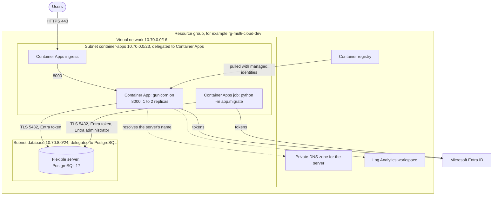
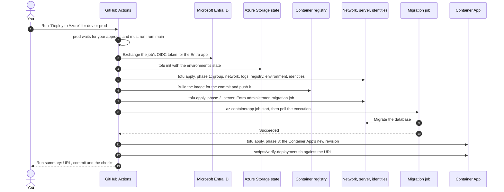
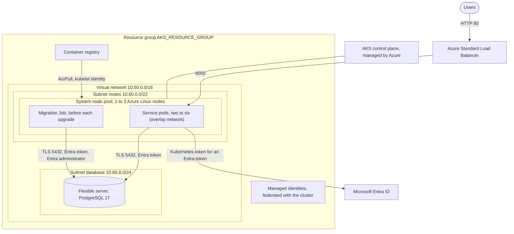
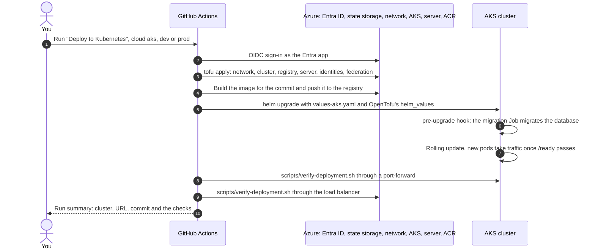

# Azure architecture

The service runs on Azure in two ways, each a separate OpenTofu folder with its own resource
group, virtual network, registry and Azure Database for PostgreSQL flexible server:

| | Container Apps | AKS |
| --- | --- | --- |
| OpenTofu folder | [`infra/azure`](../infra/azure) | [`infra/aks`](../infra/aks) |
| Deploy workflow | **Deploy to Azure** ([deploy-azure.yml](../.github/workflows/deploy-azure.yml)) | **Deploy to Kubernetes**, cloud `aks` ([deploy-kubernetes.yml](../.github/workflows/deploy-kubernetes.yml)) |
| Names (environment `dev`) | From the environment's variables, for example resource group `rg-multi-cloud-dev`, app `multi-cloud-app` | Resource group `AKS_RESOURCE_GROUP`, cluster `multi-cloud-dev` |
| Network | Virtual network `10.70.0.0/16` | Virtual network `10.60.0.0/16` |
| Runs the containers | Container App on the Consumption profile, 1 to 2 replicas | Pods on an autoscaling node pool, 1 to 3 nodes |
| Takes traffic | Container Apps ingress, HTTPS (`*.azurecontainerapps.io`) | Azure Standard Load Balancer |
| Registry | Azure Container Registry `AZURE_ACR_NAME` (Basic) | Azure Container Registry `AKS_ACR_NAME` (Standard) |
| Database | Flexible server `<AZURE_ACR_NAME>-pg`, PostgreSQL 17 | Flexible server `<AKS_ACR_NAME>-pg`, PostgreSQL 17 |
| Service signs in with | Its user-assigned managed identity's Entra token | Its managed identity's Entra token, through Workload ID |
| Migrations | A Container Apps job that the workflow starts and waits for | A Helm hook Job before every install and upgrade |
| Logs | Log Analytics | `kubectl logs` (see [Not included](#not-included)) |

The one-time subscription setup (state storage, the Entra app GitHub signs in as, its roles) is
in the [Azure deployment guide](azure-deployment.md), the chart in
[kubernetes-architecture.md](kubernetes-architecture.md), and the database code in
[database.md](database.md).

- [Container Apps](#container-apps)
  - [Request path](#aca-request-path) · [Network](#aca-network) · [Compute](#aca-compute) · [Registry](#aca-registry) · [Database](#aca-database) · [Encryption](#aca-encryption) · [Identity and access](#aca-identity-and-access) · [Logs and metrics](#aca-logs-and-metrics) · [Every resource](#aca-every-resource) · [Deployment flow](#aca-deployment-flow) · [Verify a deployment](#aca-verify-a-deployment)
- [AKS](#aks)
  - [Request path](#aks-request-path) · [Network](#aks-network) · [Cluster](#aks-cluster) · [Workload identities](#aks-workload-identities) · [Database](#aks-database) · [Encryption](#aks-encryption) · [Logs and metrics](#aks-logs-and-metrics) · [Every resource](#aks-every-resource) · [Deployment flow](#aks-deployment-flow) · [Verify a deployment](#aks-verify-a-deployment)
- [Check it without an Azure subscription](#check-it-without-an-azure-subscription)
- [Not included](#not-included)

## Container Apps



<a id="aca-request-path"></a>

### Request path

1. A user calls `https://<app>.<environment-domain>.<region>.azurecontainerapps.io`. The Container
   Apps ingress terminates TLS (plain HTTP is redirected) and sends the request to a ready
   replica on port 8000; replicas are ready once `/ready` reached the database.
2. To open a database connection the app gets a Microsoft Entra token for its user-assigned
   managed identity (`AZURE_CLIENT_ID` names which one), for the scope
   `https://ossrdbms-aad.database.windows.net/.default`.
3. It resolves `<server>.postgres.database.azure.com` through the private DNS zone to the
   server's address in the database subnet and signs in as `app_user` with the token, over TLS
   verified against the public certificate authorities.

<a id="aca-network"></a>

### Network

- **Virtual network** `azurerm_virtual_network.this`: `vnet-<app>-<environment>`, `10.70.0.0/16`
  (`vnet_cidr`).
- **Subnet** `azurerm_subnet.apps`: `container-apps`, `10.70.0.0/23`, delegated to
  `Microsoft.App/environments`. The Container Apps environment runs its replicas, jobs and
  ingress here.
- **Subnet** `azurerm_subnet.database`: `database`, `10.70.8.0/24`, delegated to
  `Microsoft.DBforPostgreSQL/flexibleServers`. Only the server lives here.
- **Private DNS** (database module): the zone `<server>.private.postgres.database.azure.com`,
  linked to the virtual network without auto-registration, which the server registers its
  address in, so its public name resolves to a private address from inside the network.
- The environment's ingress has a public address; nothing else in the network does. Container
  Apps also creates a resource group of its own (`ME_<environment>_<resource group>_<region>`)
  for the environment's infrastructure.

<a id="aca-compute"></a>

### Compute

- **Environment** `azurerm_container_app_environment.cae` (`AZURE_CONTAINER_APP_ENV`): in the
  `container-apps` subnet with the Consumption workload profile, sending logs to the Log
  Analytics workspace.
- **Container App** `azurerm_container_app.app` (`AZURE_CONTAINER_APP_NAME`): one revision at a
  time (`Single`), 1 to 2 replicas (`min_replicas`, `max_replicas`), each 0.5 vCPU and 1 GiB, on
  the Consumption profile. External ingress on port 8000 with all traffic to the latest
  revision. It runs as the user-assigned identity `<app>-identity` and pulls its image with it.
  Environment: `APP_ENV`, `APP_VERSION=<commit>`, `DB_AUTH=azure-entra`,
  `DB_HOST=<server>.postgres.database.azure.com`, `DB_NAME=app`, `DB_USER=app_user`,
  `AZURE_CLIENT_ID=<the identity's client ID>`. Probes: startup `GET /health` every 3 seconds up to
  10 times, readiness `GET /ready`, liveness `GET /health`.
- **Migration job** `azurerm_container_app_job.migrate`: `multi-cloud-app-migrate` (the app's
  name, cut to fit the 32-character limit, plus `-migrate`), started by hand (`manual_trigger_config`:
  one replica that must complete), 10 minutes per replica and one retry, 0.5 vCPU and 1 GiB,
  running `python -m app.migrate` as the identity `<app>-migrate`, the server's Entra
  administrator. It gets `DB_USER=<app>-migrate`, the migration identity's `AZURE_CLIENT_ID`,
  `DB_APP_ROLE=app_user` and `DB_APP_PRINCIPAL_ID=<the app identity's object ID>`, which it uses
  to create `app_user` for the app's identity. The Container App depends on it, and the deploy
  workflow runs it before it updates the app.

<a id="aca-registry"></a>

### Registry

`azurerm_container_registry.acr`: `AZURE_ACR_NAME` (globally unique), Basic SKU, the admin account
off. The app's and the migration job's identities each hold `AcrPull` on it
(`azurerm_role_assignment.acr_pull`, `azurerm_role_assignment.acr_pull_migration`), and nothing
else may pull.

<a id="aca-database"></a>

### Database

From [`infra/modules/azure-database`](../infra/modules/azure-database), shared with AKS:

| Setting | Value |
| --- | --- |
| Server `azurerm_postgresql_flexible_server.this` | `<AZURE_ACR_NAME>-pg` (the registry's name is globally unique already), PostgreSQL 17, `B_Standard_B1ms` (`database_sku`; a General Purpose SKU in `prod`) |
| Storage (block storage) | 32 GB (`storage_mb`), growing automatically; IOPS and throughput scale with it, General Purpose SSD |
| Encryption | Azure's own key by default; `key_vault_key_id` (see [Encryption](#aca-encryption)) encrypts it instead, wrapped by `key_vault_user_assigned_identity_id`. Set once, at creation: changing it later replaces the server |
| Network | VNet integration: an address in the delegated `database` subnet, the private DNS zone, no public endpoint |
| Sign-in | Microsoft Entra only; password authentication is off, so there is no password administrator |
| Administrator | `azurerm_postgresql_flexible_server_active_directory_administrator.migration`: the migration job's managed identity (`ServicePrincipal`) |
| Database `azurerm_postgresql_flexible_server_database.app` | `app`, UTF8, `en_US.utf8` |
| Server parameters `azurerm_postgresql_flexible_server_configuration.settings` | `require_secure_transport=on` (TLS only), `log_connections`, `log_disconnections`, `log_checkpoints` and `connection_throttle.enable` on |
| Availability | `dev`: one zone. `prod`: zone-redundant high availability, a standby in another zone |
| Backups | Kept 7 days (`prod`: 14), with point-in-time restore; not geo-redundant |
| Maintenance | Sundays from 04:00 |

The migration job creates `app_user` with `pgaadauth_create_principal_with_oid`, tied to the
app identity's object ID rather than its name, and grants it read and write access to the `app`
schema's tables; see [database.md](database.md#migrations).

<a id="aca-encryption"></a>

### Encryption

Azure's own key encrypts the server by default. `enable_customer_managed_key` creates a Key
Vault, `azurerm_key_vault.database` (name `key_vault_name`, globally unique), a key in it,
`azurerm_key_vault_key.database` (RSA 2048, wrap and unwrap only), and a user-assigned identity,
`azurerm_user_assigned_identity.database_key`, that the server uses to wrap and unwrap with it
(`key_vault_user_assigned_identity_id`, `key_vault_key_id`). Access policies, not RBAC, grant key
permissions: one for the identity running OpenTofu (create, get, list, wrap, unwrap, delete,
purge), one for the server's identity (get, wrap, unwrap only).

Azure requires the vault to have purge protection before it accepts a customer-managed key, so
destroying this environment leaves the vault soft-deleted for `soft_delete_retention_days` (7):
applying again with the same `key_vault_name` fails until that window passes, or until someone
with Key Vault purge rights removes it by hand. Enabling this after the server already exists
forces OpenTofu to replace it, since it can't switch to a customer-managed key in place.

The registry isn't covered: a customer-managed key for ACR needs the Premium SKU (this registry
uses Basic), which adds its own ongoing cost beyond the key itself.

<a id="aca-identity-and-access"></a>

### Identity and access

| Identity | Created by | Can | Used by |
| --- | --- | --- | --- |
| Entra app GitHub signs in as (`AZURE_CLIENT_ID`) | You, once ([guide](azure-deployment.md)) | Contributor on the subscription; may assign only `AcrPull` and Network Contributor; trusted through federated credentials for this repository's `dev` and `prod` environments | The deploy workflow |
| `<app>-identity` (`azurerm_user_assigned_identity.app`) | OpenTofu | Pull images; sign in to the database as `app_user` | The Container App |
| `<app>-migrate` (`azurerm_user_assigned_identity.migration`) | OpenTofu | Pull images; administer the database server | The migration job |

The tenant comes from `data.azurerm_client_config.current`.

<a id="aca-logs-and-metrics"></a>

### Logs and metrics

| What | Where | Kept |
| --- | --- | --- |
| Console output of the app and the migration job (requests, app logs, migrations) | Log Analytics workspace `azurerm_log_analytics_workspace.logs` (`log_analytics_workspace_name`), table `ContainerAppConsoleLogs_CL` | 30 days |
| Container Apps system events (revisions, replicas, scaling) | The same workspace, `ContainerAppSystemLogs_CL` | 30 days |
| Requests, replicas, CPU and memory | Azure Monitor metrics of the Container App | Azure Monitor's defaults |
| PostgreSQL logs | The server's logs in the portal (no diagnostic setting sends them elsewhere) | Azure's defaults |

`azurerm_monitor_metric_alert.restarts` (more than 5 restarts in 15 minutes) and `.error_rate`
(more than 10 server errors in 5 minutes, filtered to `statusCodeCategory` `5XX`) watch the
Container App's own metrics, alongside the database's own
`module.database.azurerm_monitor_metric_alert.cpu`, `.storage` and `.connections`. `alert_email`
creates `azurerm_monitor_action_group.alerts` every alert here and the database's notify through;
empty leaves them visible in Azure Monitor only.

<a id="aca-every-resource"></a>

### Every resource

What one `tofu apply` in `infra/azure` creates, as `scripts/inventory.sh azure` lists it:

| Resource | What it is |
| --- | --- |
| `azurerm_resource_group.rg` | The resource group |
| `azurerm_log_analytics_workspace.logs` | Log Analytics, 30 days |
| `azurerm_virtual_network.this` | The virtual network |
| `azurerm_subnet.apps` | Subnet for the Container Apps environment |
| `azurerm_subnet.database` | Subnet for the server |
| `azurerm_user_assigned_identity.database_key` | With `enable_customer_managed_key`: wraps and unwraps the database's key |
| `azurerm_key_vault.database` | Holds the key, with purge protection |
| `azurerm_key_vault_key.database` | Encrypts the database instead of Azure's own key |
| `azurerm_container_registry.acr` | Image registry |
| `azurerm_container_app_environment.cae` | The Container Apps environment |
| `azurerm_user_assigned_identity.app` | The app's identity |
| `azurerm_role_assignment.acr_pull` | It may pull images |
| `azurerm_user_assigned_identity.migration` | The migration job's identity |
| `azurerm_role_assignment.acr_pull_migration` | It may pull images |
| `module.database.azurerm_private_dns_zone.this` | Private DNS zone for the server |
| `module.database.azurerm_private_dns_zone_virtual_network_link.this` | Links it to the network |
| `module.database.azurerm_postgresql_flexible_server.this` | The PostgreSQL server |
| `module.database.azurerm_postgresql_flexible_server_database.app` | Database `app` |
| `module.database.azurerm_postgresql_flexible_server_active_directory_administrator.migration` | The migration identity as Entra administrator |
| `module.database.azurerm_postgresql_flexible_server_configuration.settings["require_secure_transport"]` | TLS only |
| `module.database.azurerm_postgresql_flexible_server_configuration.settings["log_connections"]` | Log connections |
| `module.database.azurerm_postgresql_flexible_server_configuration.settings["log_disconnections"]` | Log disconnections |
| `module.database.azurerm_postgresql_flexible_server_configuration.settings["log_checkpoints"]` | Log checkpoints |
| `module.database.azurerm_postgresql_flexible_server_configuration.settings["connection_throttle.enable"]` | Slow down repeated failed sign-ins |
| `module.database.azurerm_monitor_metric_alert.cpu` | Database CPU above 80% for 15 minutes |
| `module.database.azurerm_monitor_metric_alert.storage` | Database storage above 90% full for 15 minutes |
| `module.database.azurerm_monitor_metric_alert.connections` | More than 80 active connections for 15 minutes |
| `azurerm_container_app_job.migrate` | The migration job |
| `azurerm_container_app.app` | The Container App |
| `azurerm_monitor_action_group.alerts` | Where the alerts notify, with `alert_email` set |
| `azurerm_monitor_metric_alert.restarts` | More than 5 restarts in 15 minutes |
| `azurerm_monitor_metric_alert.error_rate` | More than 10 server errors in 5 minutes |

<a id="aca-deployment-flow"></a>

### Deployment flow



| # | Step in [deploy-azure.yml](../.github/workflows/deploy-azure.yml) | What happens | How to check it |
| --- | --- | --- | --- |
| 1 | Allow production deployments only from main | Stops a `prod` run from any branch but `main`. The `prod` environment also waits for your approval. | A run from another branch fails here. |
| 2 | `actions/checkout` | Checks out the commit being deployed. | |
| 3 | Check required configuration | Fails fast if any `AZURE_*` variable or the three secrets are missing. | The error names the setting. |
| 4 | Export OpenTofu variables | Passes the environment, resource group, region, registry, environment and app names, and the commit SHA as `TF_VAR_*`. | |
| 5 | Sign in to Azure | Exchanges the job's OIDC token for the Entra app; no client secret exists. OpenTofu reuses the same token (`ARM_USE_OIDC`). | `AADSTS700213` means the federated credential's subject doesn't match `repo:<owner>/<repo>:environment:<env>`. |
| 6 | `opentofu/setup-opentofu` | Installs OpenTofu. | |
| 7 | Initialize OpenTofu state | `tofu init` with state blob `multi-cloud-app/<environment>.tfstate` in the state container, signed in with Entra ID. | `az storage blob list --account-name <account> --container-name <container> --auth-mode login` |
| 8 | Provision registry, identities and platform | Phase 1: the resource group, Log Analytics, registry, network (pulled in by the environment), Container Apps environment, both identities and their `AcrPull` grants, so the grants can propagate while the image builds. | `az containerapp env show -g <group> -n <environment>` |
| 9 | Build and push image | Builds the image with the commit SHA as its tag and `APP_VERSION`, and pushes it. | `az acr repository show-tags --name <registry> --repository multi-cloud-app` |
| 10 | Provision the database and the migration job | Phase 2: applies the migration job and everything it needs: the server, its DNS zone, the Entra administrator and parameters. The first run takes 10 minutes or more while the server is created. | `az postgres flexible-server show -g <group> -n <registry>-pg` |
| 11 | Migrate the database | Starts the job with `az containerapp job start` and polls the execution every 10 seconds, for up to 10 minutes, until it succeeds; a failed, stopped or degraded execution fails the run before the app changes. | `az containerapp job execution list -g <group> -n multi-cloud-app-migrate -o table` |
| 12 | Deploy the Container App | Phase 3: applies the rest, the Container App's new revision. | `az containerapp revision list -g <group> -n <app> -o table` |
| 13 | Verify the deployment end to end | Runs [scripts/verify-deployment.sh](../scripts/verify-deployment.sh) against the app's URL (writes an item in `dev`) and sets the environment's URL. | The run summary's table. |

<a id="aca-verify-a-deployment"></a>

### Verify a deployment

```bash
RG=rg-multi-cloud-dev            # AZURE_RESOURCE_GROUP
APP=multi-cloud-app              # AZURE_CONTAINER_APP_NAME
SERVER=<AZURE_ACR_NAME>-pg
URL="https://$(az containerapp show -g "$RG" -n "$APP" --query properties.configuration.ingress.fqdn -o tsv)"
scripts/verify-deployment.sh "$URL" <commit SHA>

# The revision serving, its identity and settings
az containerapp show -g "$RG" -n "$APP" --query '{revision:properties.latestReadyRevisionName,identities:identity.userAssignedIdentities,env:properties.template.containers[0].env}'

# The migration executions
az containerapp job execution list -g "$RG" -n multi-cloud-app-migrate --query '[0:3].{name:name,status:properties.status,started:properties.startTime}' -o table

# Private, Entra-only, availability and backups
az postgres flexible-server show -g "$RG" -n "$SERVER" --query '{version:version,publicAccess:network.publicNetworkAccess,subnet:network.delegatedSubnetResourceId,auth:authConfig,ha:highAvailability.mode,backupDays:backup.backupRetentionDays}'
az postgres flexible-server microsoft-entra-admin list -g "$RG" -s "$SERVER" -o table
az postgres flexible-server parameter show -g "$RG" -s "$SERVER" -n require_secure_transport --query value
```

Expect a revision named after the latest commit's deployment, the `<app>-identity` identity, a
`Succeeded` execution for this run, `publicAccess` `Disabled`, password authentication
`Disabled` and Entra `Enabled`, the migration identity as administrator, and `on`.

## AKS



<a id="aks-request-path"></a>

### Request path

1. A user reaches the load balancer's public IP on port 80. AKS creates it in the cluster's
   Standard Load Balancer for the chart's `LoadBalancer` Service, probing `/health`
   (`values-aks.yaml`).
2. Traffic goes to a ready pod on port 8000; pods are ready once `/ready` reached the database.
3. The pod is labelled `azure.workload.identity/use: "true"`, so the workload identity webhook
   mounts a Kubernetes service account token and sets `AZURE_CLIENT_ID` from its service
   account's annotation. The app exchanges that token with Microsoft Entra ID for a token of the
   managed identity `multi-cloud-dev-app` (the federated credential trusts exactly that service
   account), and signs in to the server as `app_user`.

<a id="aks-network"></a>

### Network

- **Virtual network** `azurerm_virtual_network.this`: `multi-cloud-dev`, `10.60.0.0/16`
  (`vnet_cidr`).
- **Subnet** `azurerm_subnet.nodes`: `nodes`, `10.60.0.0/22`, for the nodes. Pods use Azure CNI
  overlay, so they get addresses from a private overlay range (`10.244.0.0/16`) instead of the
  subnet, and Services from `10.0.0.0/16`, both AKS's defaults.
- **Subnet** `azurerm_subnet.database`: `database`, `10.60.8.0/24`, delegated to the flexible
  server.
- **Private DNS** for the server, linked to the network, as for Container Apps.
- AKS also creates the node resource group `MC_<group>_multi-cloud-dev_<region>` with the node
  scale set, the load balancer, its public IPs and the nodes' network security group; AKS manages
  those, not OpenTofu.

<a id="aks-cluster"></a>

### Cluster

`azurerm_kubernetes_cluster.this`, `multi-cloud-dev`:

- **Tier**: Free in `dev`, Standard (with an uptime SLA) in `prod`. Kubernetes version: AKS's
  default unless `kubernetes_version` is set.
- **Upgrades**: the `stable` automatic upgrade channel for Kubernetes, `NodeImage` for node OS
  images.
- **Identity**: a system-assigned identity for the cluster, which holds Network Contributor on
  the `nodes` subnet (`azurerm_role_assignment.cluster_network`) so it can scale nodes into it;
  the kubelet identity holds `AcrPull` on the registry (`azurerm_role_assignment.acr_pull`).
- **Workload identity**: the OIDC issuer and Microsoft Entra Workload ID are on; RBAC is on.
- **Nodes**: one system pool, `system`, of `Standard_D2s_v5` (`node_vm_size`) running Azure Linux,
  scaled by the cluster autoscaler between 1 and 3 nodes, in the `nodes` subnet, upgraded with
  10% surge; node auto-provisioning is off (`node_provisioning_profile` `Manual`).
- **Networking**: Azure CNI in overlay mode with the Cilium data plane, which also enforces the
  chart's network policies; Standard load balancer.
- **API server**: public, because GitHub-hosted runners have no fixed address; set
  `api_allowed_cidrs` to allow only some addresses.
- **Container Insights**: the `oms_agent` add-on sends node and pod metrics and logs to its own
  Log Analytics workspace, `azurerm_log_analytics_workspace.logs` (`log_analytics_workspace_name`),
  separate from Container Apps'.

The registry `azurerm_container_registry.this` is `AKS_ACR_NAME`, Standard SKU, admin account off.
The chart's objects in the cluster are in [kubernetes-architecture.md](kubernetes-architecture.md).

<a id="aks-workload-identities"></a>

### Workload identities

| Kubernetes service account | Managed identity | Can | Federated credential |
| --- | --- | --- | --- |
| `multi-cloud-app/multi-cloud-app` | `multi-cloud-dev-app` (`azurerm_user_assigned_identity.app`) | Sign in to the database as `app_user` | `azurerm_federated_identity_credential.workload["multi-cloud-app"]` |
| `multi-cloud-app/multi-cloud-app-migrate` | `multi-cloud-dev-migrate` (`azurerm_user_assigned_identity.migration`) | Administer the database server | `azurerm_federated_identity_credential.workload["multi-cloud-app-migrate"]` |

Each federated credential trusts tokens from the cluster's OIDC issuer with the subject
`system:serviceaccount:multi-cloud-app:<service account>` and the audience
`api://AzureADTokenExchange`. The chart annotates each service account with
`azure.workload.identity/client-id`, from OpenTofu's `helm_values`.

<a id="aks-database"></a>

### Database

The same module and settings as [Container Apps' database](#aca-database), named
`<AKS_ACR_NAME>-pg`, in the `database` subnet. The migration Job signs in as the administrator
identity `multi-cloud-dev-migrate` and creates `app_user` for `multi-cloud-dev-app`'s object ID.
The tenant comes from `data.azurerm_client_config.current`.

<a id="aks-encryption"></a>

### Encryption

The same pattern as [Container Apps'](#aca-encryption): `enable_customer_managed_key` creates
this target's own Key Vault, key and user-assigned identity
(`azurerm_key_vault.database`, `azurerm_key_vault_key.database`,
`azurerm_user_assigned_identity.database_key`). The ACR registry isn't covered: a
customer-managed key for it needs the Premium SKU (this cluster uses Standard), which adds its
own ongoing cost beyond the key itself.

<a id="aks-logs-and-metrics"></a>

### Logs and metrics

The control plane's own logs (`kube-apiserver`, `kube-audit`, `kube-controller-manager`,
`kube-scheduler`, `cluster-autoscaler`, `guard`) go to the same workspace as Container Insights
through `azurerm_monitor_diagnostic_setting.aks`. `azurerm_monitor_metric_alert.node_cpu` (node
CPU above 80% for 15 minutes) and `.node_memory` (node memory above 80% for 15 minutes) watch
platform metrics that need no agent, alongside the database's own
`module.database.azurerm_monitor_metric_alert.cpu`, `.storage` and `.connections`. `alert_email`
creates `azurerm_monitor_action_group.alerts` every alert here and the database's notify through,
the same pattern as [Container Apps'](#aca-logs-and-metrics); empty leaves them visible in Azure
Monitor only.

<a id="aks-every-resource"></a>

### Every resource

What one `tofu apply` in `infra/aks` creates, as `scripts/inventory.sh aks` lists it, plus the
nodes' `AcrPull` assignment, which the dry run leaves out (it reads an identity AKS fills in
after creating the cluster):

| Resource | What it is |
| --- | --- |
| `azurerm_resource_group.this` | The resource group |
| `azurerm_virtual_network.this` | The virtual network |
| `azurerm_subnet.nodes` | Node subnet |
| `azurerm_subnet.database` | Server subnet |
| `azurerm_user_assigned_identity.database_key` | With `enable_customer_managed_key`: wraps and unwraps the database's key |
| `azurerm_key_vault.database` | Holds the key, with purge protection |
| `azurerm_key_vault_key.database` | Encrypts the database instead of Azure's own key |
| `azurerm_container_registry.this` | Image registry |
| `azurerm_log_analytics_workspace.logs` | Container Insights and the control plane's logs, 30 days |
| `azurerm_kubernetes_cluster.this` | The AKS cluster |
| `azurerm_monitor_diagnostic_setting.aks` | Sends the control plane's logs to the workspace |
| `azurerm_role_assignment.cluster_network` | The cluster may join nodes to its subnet |
| `azurerm_role_assignment.acr_pull` | The nodes may pull images |
| `azurerm_user_assigned_identity.app` | The service's identity |
| `azurerm_user_assigned_identity.migration` | The migration Job's identity |
| `azurerm_federated_identity_credential.workload["multi-cloud-app"]` | Trusts the service's service account |
| `azurerm_federated_identity_credential.workload["multi-cloud-app-migrate"]` | Trusts the Job's service account |
| `azurerm_monitor_action_group.alerts` | Where the alerts notify, with `alert_email` set |
| `azurerm_monitor_metric_alert.node_cpu` | Node CPU above 80% for 15 minutes |
| `azurerm_monitor_metric_alert.node_memory` | Node memory above 80% for 15 minutes |
| `module.database.azurerm_private_dns_zone.this` | Private DNS zone for the server |
| `module.database.azurerm_private_dns_zone_virtual_network_link.this` | Links it to the network |
| `module.database.azurerm_postgresql_flexible_server.this` | The PostgreSQL server |
| `module.database.azurerm_postgresql_flexible_server_database.app` | Database `app` |
| `module.database.azurerm_postgresql_flexible_server_active_directory_administrator.migration` | The migration identity as Entra administrator |
| `module.database.azurerm_postgresql_flexible_server_configuration.settings["require_secure_transport"]` | TLS only |
| `module.database.azurerm_postgresql_flexible_server_configuration.settings["log_connections"]` | Log connections |
| `module.database.azurerm_postgresql_flexible_server_configuration.settings["log_disconnections"]` | Log disconnections |
| `module.database.azurerm_postgresql_flexible_server_configuration.settings["log_checkpoints"]` | Log checkpoints |
| `module.database.azurerm_postgresql_flexible_server_configuration.settings["connection_throttle.enable"]` | Slow down repeated failed sign-ins |
| `module.database.azurerm_monitor_metric_alert.cpu` | Database CPU above 80% for 15 minutes |
| `module.database.azurerm_monitor_metric_alert.storage` | Database storage above 90% full for 15 minutes |
| `module.database.azurerm_monitor_metric_alert.connections` | More than 80 active connections for 15 minutes |

<a id="aks-deployment-flow"></a>

### Deployment flow



[deploy-kubernetes.yml](../.github/workflows/deploy-kubernetes.yml) is shared by the three
clusters; [kubernetes-architecture.md](kubernetes-architecture.md#deployment-flow) explains every
step. On AKS:

- **Authenticate to Azure** signs in as the Entra app with the job's OIDC token, and OpenTofu
  reuses the token (`ARM_USE_OIDC`).
- **Initialize OpenTofu state** keeps state in blob `multi-cloud-aks/<environment>.tfstate`.
- **Create or update the cluster** applies everything above; the first run takes 15 minutes or
  more.
- **Build and push image** logs in with `az acr login` and pushes to `<AKS_ACR_NAME>.azurecr.io/multi-cloud-app`.
- **Get AKS or EKS credentials** runs `az aks get-credentials`.

<a id="aks-verify-a-deployment"></a>

### Verify a deployment

```bash
AKS_RG=<AKS_RESOURCE_GROUP>
az aks get-credentials -g "$AKS_RG" -n multi-cloud-dev

# OIDC issuer, Workload ID, overlay with Cilium, tier and upgrade channels
az aks show -g "$AKS_RG" -n multi-cloud-dev --query '{oidcIssuer:oidcIssuerProfile.enabled,workloadIdentity:securityProfile.workloadIdentity.enabled,plugin:networkProfile.networkPlugin,mode:networkProfile.networkPluginMode,policy:networkProfile.networkPolicy,tier:sku.tier,upgrades:autoUpgradeProfile}'

# The federated credentials
az identity federated-credential list -g "$AKS_RG" --identity-name multi-cloud-dev-app -o table
az identity federated-credential list -g "$AKS_RG" --identity-name multi-cloud-dev-migrate -o table

# The release, the migration Job and its log
kubectl get deployment,pods,service,job,networkpolicy --namespace multi-cloud-app
kubectl logs job/multi-cloud-app-migrate --namespace multi-cloud-app

# The checks the workflow ran, through the load balancer
ADDRESS="$(kubectl get service multi-cloud-app --namespace multi-cloud-app -o jsonpath='{.status.loadBalancer.ingress[0].ip}')"
scripts/verify-deployment.sh "http://${ADDRESS}" <commit SHA>
```

## Check it without an Azure subscription

Each folder has OpenTofu tests that plan it against a mock Azure provider, so they need no
subscription or credentials, and CI runs them on every pull request:

```bash
cd infra/azure && tofu init -backend=false && tofu test      # Container Apps
cd infra/aks && tofu init -backend=false && tofu test        # AKS: dev and prod
cd infra/modules/azure-database && tofu init -backend=false && tofu test   # flexible server: dev and prod
scripts/inventory.sh azure aks                                # every resource each would create
```

They check, among others: the environment in its delegated subnet, the app and the job using
separate identities with only `AcrPull`, the app signing in as `app_user` with its identity's
client ID, the `/ready` readiness probe, the job's command and the object ID it creates
`app_user` for, the cluster's OIDC issuer, Workload ID, overlay and Cilium settings, the
federated credentials' subjects and audience, the server having no public access and only Entra
sign-in, TLS being required, and the `dev` and `prod` differences. See
[`infra/azure/tests`](../infra/azure/tests), [`infra/aks/tests`](../infra/aks/tests) and
[`infra/modules/azure-database/tests`](../infra/modules/azure-database/tests).

## Not included

- **Network security groups** on the subnets of our own (Container Apps and AKS bring their own
  rules; the delegated database subnet relies on VNet integration).
- **HTTPS on AKS:** the load balancer serves HTTP; an ingress controller or Application Gateway
  with a certificate and a domain would add TLS. (The Container Apps URL is HTTPS already.)
- **Azure Front Door or Application Gateway with a web application firewall.**
- **Private registries** (Premium SKU with private endpoints) and **Microsoft Defender for Cloud**.
  A customer-managed key for ACR needs that same Premium SKU; the database's key
  (`enable_customer_managed_key`) doesn't.
- **Geo-redundant backups** of the server, and **budgets** in Azure Monitor (`alert_email` wires
  the CPU, storage, connections, restart, error rate and AKS node CPU/memory alerts, with
  Container Insights and the control plane's logs now in Log Analytics).
- **A private AKS API server**, which needs self-hosted runners inside the network.
