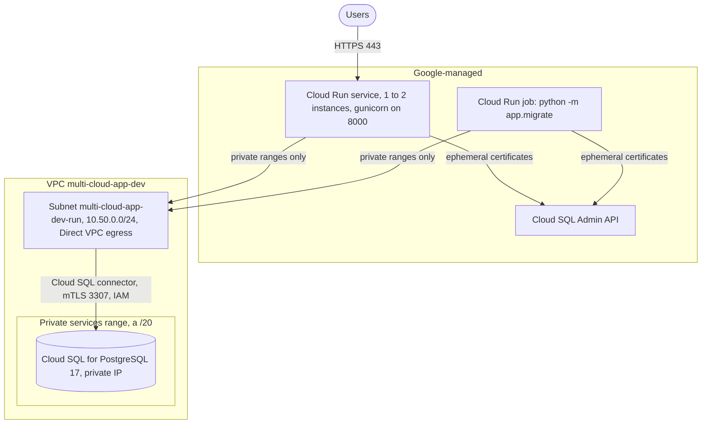
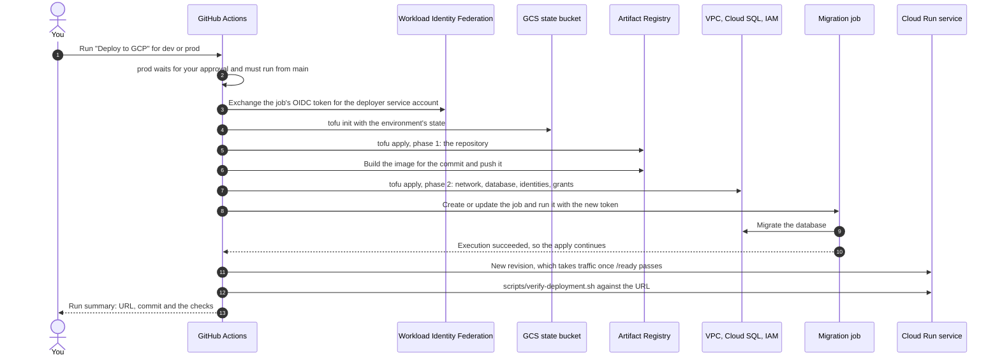
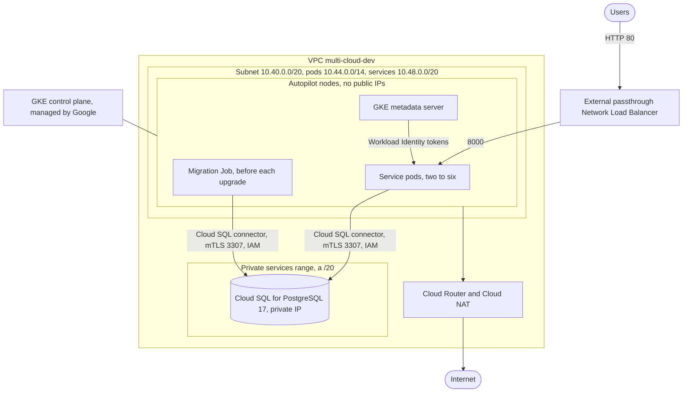
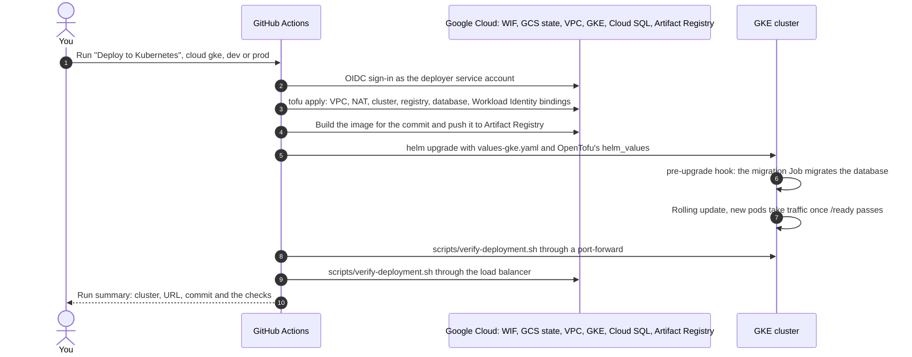

# Google Cloud architecture

The service runs on Google Cloud in two ways, each a separate OpenTofu folder with its own VPC,
registry and Cloud SQL for PostgreSQL instance:

| | Cloud Run | GKE Autopilot |
| --- | --- | --- |
| OpenTofu folder | [`infra/gcp`](../infra/gcp) | [`infra/gke`](../infra/gke) |
| Deploy workflow | **Deploy to GCP** ([deploy-gcp.yml](../.github/workflows/deploy-gcp.yml)) | **Deploy to Kubernetes**, cloud `gke` ([deploy-kubernetes.yml](../.github/workflows/deploy-kubernetes.yml)) |
| Names (environment `dev`) | `multi-cloud-app-dev` (`GCP_SERVICE_NAME`) | `multi-cloud-dev` (`<cluster_name>-<environment>`) |
| Network | VPC with subnet `10.50.0.0/24` for Direct VPC egress | VPC with subnet `10.40.0.0/20`, pods `10.44.0.0/14`, services `10.48.0.0/20` |
| Runs the containers | Cloud Run service, 1 to 2 instances | Pods on Autopilot nodes with no public IPs |
| Takes traffic | Cloud Run's HTTPS endpoint (`*.run.app`) | External passthrough Network Load Balancer |
| Registry | Artifact Registry `GCP_REPOSITORY` | Artifact Registry `multi-cloud-app-gke` |
| Database | Cloud SQL for PostgreSQL 17, private IP only | Cloud SQL for PostgreSQL 17, private IP only |
| Service signs in with | Its service account, through IAM database authentication | Its service account (Workload Identity Federation), through IAM database authentication |
| Migrations | A Cloud Run job, which OpenTofu runs and waits for | A Helm hook Job before every install and upgrade |
| Logs | Cloud Logging | Cloud Logging |

The one-time project setup (state bucket, deployer service account, Workload Identity Federation
for GitHub) is in the [GCP deployment guide](gcp-deployment.md), the chart in
[kubernetes-architecture.md](kubernetes-architecture.md), and the database code in
[database.md](database.md).

- [Cloud Run](#cloud-run)
  - [Request path](#cloud-run-request-path) · [Network](#cloud-run-network) · [Compute](#cloud-run-compute) · [Registry](#cloud-run-registry) · [Database](#cloud-run-database) · [Identity and access](#cloud-run-identity-and-access) · [Logs and metrics](#cloud-run-logs-and-metrics) · [Every resource](#cloud-run-every-resource) · [Deployment flow](#cloud-run-deployment-flow) · [Verify a deployment](#cloud-run-verify-a-deployment)
- [GKE Autopilot](#gke-autopilot)
  - [Request path](#gke-request-path) · [Network](#gke-network) · [Cluster](#gke-cluster) · [Workload identities](#gke-workload-identities) · [Database](#gke-database) · [Logs and metrics](#gke-logs-and-metrics) · [Every resource](#gke-every-resource) · [Deployment flow](#gke-deployment-flow) · [Verify a deployment](#gke-verify-a-deployment)
- [Check it without a Google Cloud project](#check-it-without-a-google-cloud-project)
- [Not included](#not-included)

## Cloud Run



<a id="cloud-run-request-path"></a>

### Request path

1. A user calls the service's `https://<service>-<hash>-<region>.a.run.app` URL. Cloud Run
   terminates TLS and routes to an instance; `allUsers` holds the invoker role, so the URL is
   public.
2. An instance only receives traffic once its startup probe, `GET /ready`, answered 200, so it
   reached the database.
3. The app asks the Cloud SQL Python Connector for a connection. The connector gets the
   instance's private IP and a short-lived client certificate from the Cloud SQL Admin API, opens
   mutual TLS to the instance on port 3307 through the VPC subnet, and signs in as the service
   account's IAM database user with an OAuth token. No password exists.

<a id="cloud-run-network"></a>

### Network

- **VPC** `google_compute_network.this`: `multi-cloud-app-dev`, custom subnets only.
- **Subnet** `google_compute_subnetwork.run`: `multi-cloud-app-dev-run`, `10.50.0.0/24`
  (`subnet_cidr`), with Private Google Access and flow logs (10-minute aggregation, half of the
  flows sampled, all metadata). The service's instances and the job's tasks get addresses here
  (Direct VPC egress) and send only private-range traffic through it (`PRIVATE_RANGES_ONLY`);
  everything else, such as calls to Google APIs, leaves straight from Cloud Run, so the VPC needs
  no Cloud NAT.
- **Private services access**: the database module reserves a `/20` in the VPC
  (`google_compute_global_address.private_services`, `multi-cloud-app-dev-private-services`) and
  peers it with Google's service network (`google_service_networking_connection.private_services`).
  The Cloud SQL instance's private IP comes from that range. The peering is left in place when
  the database is destroyed (`deletion_policy = ABANDON`), because Google removes it only after
  the instance is gone.
- There are no firewall rules of our own: nothing in the VPC needs to accept inbound traffic, and
  Cloud SQL is reached through the peering.

<a id="cloud-run-compute"></a>

### Compute

- **Service** `google_cloud_run_v2_service.app`: `multi-cloud-app-dev`, public ingress, running as
  the service account `multi-cloud-app-dev-app`. One container from the commit's image on port
  8000 with 1 vCPU and 512 MiB, 1 to 2 instances (`min_instances`, `max_instances`), Direct VPC
  egress through the subnet above. Environment: `APP_ENV`, `APP_VERSION=<commit>`,
  `DB_AUTH=gcp-iam`, `DB_INSTANCE=<project>:<region>:multi-cloud-app-dev`, `DB_NAME=app`,
  `DB_USER=multi-cloud-app-dev-app@<project>.iam`, `DB_CONNECT_TIMEOUT=10`. Startup probe
  `GET /ready` every 3 seconds, up to 20 times; liveness probe `GET /health` every 30 seconds. It
  depends on the migration job, so OpenTofu only rolls out a new revision after the migrations
  succeeded. Deletion protection is on unless `deletion_protection` is false.
- **Public access** `google_cloud_run_v2_service_iam_member.public_access`: `roles/run.invoker`
  for `allUsers`. Remove it to require authenticated callers.
- **Migration job** `google_cloud_run_v2_job.migrate`: `multi-cloud-app-dev-migrate`, one task of
  `python -m app.migrate` with 1 vCPU and 512 MiB, at most one retry and a 10-minute timeout, as
  the service account `multi-cloud-app-dev-migrate`, with the same Direct VPC egress. Each
  deployment passes a new `migration_token` (`<run ID>-<attempt>`), and setting
  `run_execution_token` to it makes OpenTofu start an execution and wait until it succeeds; if it
  fails, the apply fails before the service changes. A plain `tofu apply` without a token runs
  nothing. The job's name and the token must stay under 63 characters together, which a
  precondition checks.

<a id="cloud-run-registry"></a>

### Registry

`google_artifact_registry_repository.app_repo`: a Docker repository named `GCP_REPOSITORY` (one per
environment, for example `multi-cloud-app-dev`) in the region. The image is
`<region>-docker.pkg.dev/<project>/<repository>/multi-cloud-app:<commit>`. Cloud Run's own service
agent pulls it.

<a id="cloud-run-database"></a>

### Database

From [`infra/modules/gcp-database`](../infra/modules/gcp-database), shared with GKE:

| Setting | Value |
| --- | --- |
| Instance `google_sql_database_instance.this` | `multi-cloud-app-dev`, `POSTGRES_17`, Enterprise edition, `db-custom-1-3840` (1 vCPU, 3.75 GB, 100 connections; `database_tier`) |
| Storage | 10 GB SSD, growing automatically |
| Network | Private IP from the private services range; no public IP (`ipv4_enabled = false`) |
| Connections | Only through the Cloud SQL connectors (`connector_enforcement = REQUIRED`), which authorize every connection with IAM (`roles/cloudsql.client`) and encrypt it with certificates they fetch; unencrypted connections are refused (`ssl_mode = ENCRYPTED_ONLY`) |
| Sign-in | IAM database authentication (`cloudsql.iam_authentication=on`); no built-in user has a password |
| Database `google_sql_database.app` | `app` |
| Users | `google_sql_user.app`: the service's service account, an IAM user with no roles. `google_sql_user.migration`: the migration service account, an IAM user with `cloudsqlsuperuser` |
| Logging | `log_connections`, `log_disconnections`, `log_checkpoints`, `log_lock_waits` on, `log_temp_files=0` (every temporary file); Query Insights on |
| Availability | `dev`: one zone (`ZONAL`). `prod`: a standby in another zone (`REGIONAL`) |
| Backups | Daily from 03:00 UTC, 7 kept (`prod`: 14), point-in-time recovery with 7 days of transaction logs |
| Maintenance | Sundays from 04:00 UTC, on the stable track |
| Deletion | Protected in OpenTofu and in Cloud SQL itself unless `deletion_protection` is false. A deleted instance's name can't be reused for about a week |

The migration job doesn't create the service's database user (Cloud SQL did, from the IAM user
resource); it grants it read and write access to the `app` schema's tables; see
[database.md](database.md#migrations).

<a id="cloud-run-identity-and-access"></a>

### Identity and access

| Identity | Created by | Can | Used by |
| --- | --- | --- | --- |
| Deployer service account (`GCP_SERVICE_ACCOUNT`) | You, once ([guide](gcp-deployment.md)) | Create everything here; grant the two Cloud SQL roles and nothing else; trusted through Workload Identity Federation by this repository only | The deploy workflow |
| `multi-cloud-app-dev-app` (`google_service_account.app`) | OpenTofu | `roles/cloudsql.client` and `roles/cloudsql.instanceUser` on this instance only | The Cloud Run service |
| `multi-cloud-app-dev-migrate` (`google_service_account.migration`) | OpenTofu | The same two roles on this instance, and `cloudsqlsuperuser` inside the database | The migration job |
| Cloud Run service agent | Google | Pull from Artifact Registry in the project | Cloud Run |

The four grants are `google_project_iam_member.database_access["app-client"]`, `["app-login"]`,
`["migration-client"]` and `["migration-login"]`, each with the IAM condition
`resource.name == 'projects/<project>/instances/multi-cloud-app-dev' && resource.service == 'sqladmin.googleapis.com'`,
so they don't reach any other Cloud SQL instance in the project.

<a id="cloud-run-logs-and-metrics"></a>

### Logs and metrics

| What | Where |
| --- | --- |
| Requests (Cloud Run's request log and gunicorn's access log) and app logs | Cloud Logging, resource `cloud_run_revision`, service `multi-cloud-app-dev` |
| Migration output | Cloud Logging, resource `cloud_run_job`, job `multi-cloud-app-dev-migrate` |
| Request count, latency, instances, CPU and memory | Cloud Monitoring, Cloud Run metrics |
| PostgreSQL logs and query statistics | Cloud Logging (`cloudsql_database`) and Query Insights |
| Network flows | VPC flow logs of `multi-cloud-app-dev-run`, in Cloud Logging |

`google_monitoring_alert_policy.error_rate` (more than 10 server errors in 5 minutes) and
`.latency` (p99 above 1s for 15 minutes) watch the Cloud Run metrics above, alongside the
database's own `module.database.google_monitoring_alert_policy.cpu`, `.disk` and `.connections`.
`google_monitoring_dashboard.app` puts the service and database side by side in one Cloud
Monitoring dashboard. `alert_email`, when set, creates `google_monitoring_notification_channel.email`
every alert here and the database's share; empty leaves them visible in Cloud Monitoring only.

<a id="cloud-run-every-resource"></a>

### Every resource

What one `tofu apply` in `infra/gcp` creates, as `scripts/inventory.sh gcp` lists it:

| Resource | What it is |
| --- | --- |
| `google_compute_network.this` | The VPC |
| `google_compute_subnetwork.run` | Subnet for Direct VPC egress, with flow logs |
| `google_artifact_registry_repository.app_repo` | Image repository |
| `module.database.google_compute_global_address.private_services` | The `/20` reserved for Cloud SQL |
| `module.database.google_service_networking_connection.private_services` | Peering with Google's service network |
| `module.database.google_sql_database_instance.this` | The PostgreSQL instance |
| `module.database.google_sql_database.app` | Database `app` |
| `module.database.google_service_account.app` | The service's identity |
| `module.database.google_service_account.migration` | The migration job's identity |
| `module.database.google_sql_user.app` | The service's IAM database user |
| `module.database.google_sql_user.migration` | The migration IAM database user, `cloudsqlsuperuser` |
| `module.database.google_project_iam_member.database_access["app-client"]` | Service: connect through a connector |
| `module.database.google_project_iam_member.database_access["app-login"]` | Service: sign in with IAM |
| `module.database.google_project_iam_member.database_access["migration-client"]` | Job: connect through a connector |
| `module.database.google_project_iam_member.database_access["migration-login"]` | Job: sign in with IAM |
| `module.database.google_monitoring_alert_policy.cpu` | Database CPU above 80% for 15 minutes |
| `module.database.google_monitoring_alert_policy.disk` | Database disk above 80% full for 15 minutes |
| `module.database.google_monitoring_alert_policy.connections` | More than 80 connections for 15 minutes |
| `google_cloud_run_v2_job.migrate` | The migration job |
| `google_cloud_run_v2_service.app` | The service |
| `google_cloud_run_v2_service_iam_member.public_access` | Public invoker |
| `google_monitoring_notification_channel.email` | Where the alerts notify, with `alert_email` set |
| `google_monitoring_alert_policy.error_rate` | More than 10 server errors in 5 minutes |
| `google_monitoring_alert_policy.latency` | p99 request latency above 1s for 15 minutes |
| `google_monitoring_dashboard.app` | Service and database metrics together |

<a id="cloud-run-deployment-flow"></a>

### Deployment flow



| # | Step in [deploy-gcp.yml](../.github/workflows/deploy-gcp.yml) | What happens | How to check it |
| --- | --- | --- | --- |
| 1 | Allow production deployments only from main | Stops a `prod` run from any branch but `main`. The `prod` environment also waits for your approval. | A run from another branch fails here. |
| 2 | `actions/checkout` | Checks out the commit being deployed. | |
| 3 | Check required configuration | Fails fast if `GCP_PROJECT_ID`, `GCP_REGION`, `GCP_REPOSITORY`, `GCP_SERVICE_NAME`, `GCP_TF_STATE_BUCKET` or the two secrets are missing. | The error names the setting. |
| 4 | Export OpenTofu variables | Passes the environment, project, region, repository, service name, image name, commit SHA and the migration token `<run ID>-<attempt>` as `TF_VAR_*`. | |
| 5 | Authenticate to Google Cloud | Exchanges the job's OIDC token for short-lived credentials as the deployer service account; no key exists. | `iam.serviceAccounts.getAccessToken denied` means the Workload Identity binding doesn't name this repository. |
| 6 | `google-github-actions/setup-gcloud` | Installs gcloud with those credentials. | |
| 7 | `opentofu/setup-opentofu` | Installs OpenTofu. | |
| 8 | Initialize OpenTofu state | `tofu init` with state under `gs://<GCP_TF_STATE_BUCKET>/<GCP_SERVICE_NAME>/<environment>/`. | `gcloud storage ls gs://<bucket>/<service>/<environment>/` |
| 9 | Provision Artifact Registry | Phase 1: applies only the repository. | `gcloud artifacts repositories describe <repository> --location <region>` |
| 10 | Build and push image | Builds the image with the commit SHA as its tag and `APP_VERSION`, and pushes it. | `gcloud artifacts docker images list <region>-docker.pkg.dev/<project>/<repository>/multi-cloud-app --include-tags` |
| 11 | Migrate the database and deploy Cloud Run | Phase 2: applies the network, the database, the identities and grants, the migration job (running it and waiting for success), then the service. | The plan in the log; `gcloud run jobs executions list --job <service>-migrate --region <region>`. The first run takes 15 minutes or more while Cloud SQL is created. |
| 12 | Verify the deployment end to end | Runs [scripts/verify-deployment.sh](../scripts/verify-deployment.sh) against the service's URL (writes an item in `dev`) and sets the environment's URL. | The run summary's table. |

<a id="cloud-run-verify-a-deployment"></a>

### Verify a deployment

```bash
SERVICE=multi-cloud-app-dev   # GCP_SERVICE_NAME
REGION=us-central1            # GCP_REGION
URL="$(gcloud run services describe "$SERVICE" --region "$REGION" --format='value(status.url)')"
scripts/verify-deployment.sh "$URL" <commit SHA>

# Its own service account, Direct VPC egress, the commit it runs
gcloud run services describe "$SERVICE" --region "$REGION" \
  --format='yaml(spec.template.spec.serviceAccountName,spec.template.metadata.annotations,spec.template.spec.containers[0].env)'

# The migration executions and the latest one's output
gcloud run jobs executions list --job "${SERVICE}-migrate" --region "$REGION" --limit 3
gcloud logging read "resource.type=cloud_run_job AND resource.labels.job_name=${SERVICE}-migrate" --limit 20 --format='value(textPayload)'

# Private IP only, connectors only, encrypted, availability, backups
gcloud sql instances describe "$SERVICE" --format='yaml(settings.ipConfiguration.ipv4Enabled,settings.ipConfiguration.sslMode,settings.connectorEnforcement,settings.availabilityType,settings.backupConfiguration,ipAddresses)'

# Two IAM database users and no password user of ours
gcloud sql users list --instance "$SERVICE" --format='table(name,type)'
```

Expect your service account and `run.googleapis.com/network-interfaces` in the service's
annotations, a `Succeeded` execution for this run, `ipv4Enabled: false`, `ENCRYPTED_ONLY`,
`REQUIRED`, only a `PRIVATE` address, and two `CLOUD_IAM_SERVICE_ACCOUNT` users.

## GKE Autopilot



<a id="gke-request-path"></a>

### Request path

1. A user reaches the load balancer's IP on port 80; GKE creates an external passthrough Network
   Load Balancer for the chart's `LoadBalancer` Service (`values-gke.yaml`).
2. Traffic goes to a ready pod on port 8000; pods are ready once `/ready` reached the database.
3. The pod's Kubernetes service account acts as the Google service account `multi-cloud-dev-app`
   through Workload Identity Federation for GKE: the GKE metadata server hands it tokens. With
   them the Cloud SQL connector connects to the instance's private IP over mutual TLS on 3307 and
   signs in through IAM.

<a id="gke-network"></a>

### Network

- **VPC** `google_compute_network.this`: `multi-cloud-dev`, custom subnets only.
- **Subnet** `google_compute_subnetwork.this`: `multi-cloud-dev`, nodes in `10.40.0.0/20`
  (`subnet_cidr`), secondary ranges `pods` `10.44.0.0/14` and `services` `10.48.0.0/20` for a
  VPC-native cluster; Private Google Access on; flow logs (10-minute aggregation, half sampled,
  all metadata).
- **Cloud Router and Cloud NAT** `google_compute_router.this`, `google_compute_router_nat.this`:
  outbound internet access for the private nodes (for example public base images), with
  automatically allocated IPs for every range of every subnet, and NAT errors logged.
- **Private services access** for Cloud SQL, as for Cloud Run: a reserved `/20`
  (`multi-cloud-dev-private-services`) peered with Google's service network.

<a id="gke-cluster"></a>

### Cluster

`google_container_cluster.this`, `multi-cloud-dev`:

- **Autopilot**: Google runs, patches and scales the nodes, and bills per pod. Autopilot also
  turns on Workload Identity Federation (pool `<project>.svc.id.goog`), GKE Dataplane V2, which
  enforces the chart's network policies, and Shielded nodes.
- **Regional**: the control plane and nodes span the region's zones.
- **Release channel** `REGULAR`: Google upgrades the control plane and nodes automatically.
- **Private nodes**: nodes get no public IPs. The API keeps a public endpoint, because
  GitHub-hosted runners have no fixed address, limited to `api_allowed_cidrs` (master authorized
  networks; default anywhere).
- **Deletion protection** on unless `deletion_protection` is false.
- **Image pulls**: Autopilot nodes run as the project's default compute service account, which
  `google_artifact_registry_repository_iam_member.nodes_pull` lets read (`roles/artifactregistry.reader`)
  the repository `google_artifact_registry_repository.app` (`multi-cloud-app-gke`, separate from
  Cloud Run's so both can share a project).

The chart's objects in the cluster are in [kubernetes-architecture.md](kubernetes-architecture.md).

<a id="gke-workload-identities"></a>

### Workload identities

| Kubernetes service account | Google service account | Can | Binding |
| --- | --- | --- | --- |
| `multi-cloud-app/multi-cloud-app` | `multi-cloud-dev-app` | Connect to and sign in to this instance | `google_service_account_iam_member.workload_identity["multi-cloud-app"]` |
| `multi-cloud-app/multi-cloud-app-migrate` | `multi-cloud-dev-migrate` | The same, and `cloudsqlsuperuser` inside the database | `google_service_account_iam_member.workload_identity["multi-cloud-app-migrate"]` |

Each binding gives `serviceAccount:<project>.svc.id.goog[multi-cloud-app/<service account>]`
`roles/iam.workloadIdentityUser` on its Google service account, and depends on the cluster,
because the identity pool only exists once the cluster does. The chart annotates each Kubernetes
service account with `iam.gke.io/gcp-service-account`, from OpenTofu's `helm_values`.

<a id="gke-database"></a>

### Database

The same module and settings as [Cloud Run's database](#cloud-run-database), named
`multi-cloud-dev`, with the users `multi-cloud-dev-app@<project>.iam` and
`multi-cloud-dev-migrate@<project>.iam`. The pods connect through the connector on port 3307,
which the chart's network policy allows only to the private services range, and reach the Cloud
SQL Admin API on 443.

<a id="gke-logs-and-metrics"></a>

### Logs and metrics

GKE Autopilot sends node and container metrics to Cloud Monitoring on its own, no agent needed.
`google_monitoring_alert_policy.node_cpu` (allocatable CPU above 80% for 15 minutes) and
`.container_restarts` (more than 5 restarts in 15 minutes) watch them, alongside the database's
own `module.database.google_monitoring_alert_policy.cpu`, `.disk` and `.connections`.
`google_monitoring_dashboard.app` puts the cluster and database side by side. `alert_email`
wires every alert here to the same channel as [Cloud Run's](#cloud-run-logs-and-metrics)
(`google_monitoring_notification_channel.email`); empty leaves them visible in Cloud Monitoring
only.

<a id="gke-every-resource"></a>

### Every resource

What one `tofu apply` in `infra/gke` creates, as `scripts/inventory.sh gke` lists it:

| Resource | What it is |
| --- | --- |
| `google_compute_network.this` | The VPC |
| `google_compute_subnetwork.this` | Node subnet with pod and service ranges, flow logs |
| `google_compute_router.this` | Cloud Router for NAT |
| `google_compute_router_nat.this` | Cloud NAT for the private nodes |
| `google_artifact_registry_repository.app` | Image repository `multi-cloud-app-gke` |
| `google_container_cluster.this` | The Autopilot cluster |
| `google_artifact_registry_repository_iam_member.nodes_pull` | Nodes may read images |
| `google_service_account_iam_member.workload_identity["multi-cloud-app"]` | The service's pods act as its service account |
| `google_service_account_iam_member.workload_identity["multi-cloud-app-migrate"]` | The Job's pods act as the migration service account |
| `google_monitoring_notification_channel.email` | Where the alerts notify, with `alert_email` set |
| `google_monitoring_alert_policy.node_cpu` | Node allocatable CPU above 80% for 15 minutes |
| `google_monitoring_alert_policy.container_restarts` | More than 5 container restarts in 15 minutes |
| `google_monitoring_dashboard.app` | Cluster and database metrics together |
| `module.database.google_compute_global_address.private_services` | The `/20` reserved for Cloud SQL |
| `module.database.google_service_networking_connection.private_services` | Peering with Google's service network |
| `module.database.google_sql_database_instance.this` | The PostgreSQL instance |
| `module.database.google_sql_database.app` | Database `app` |
| `module.database.google_service_account.app` | The service's identity |
| `module.database.google_service_account.migration` | The migration Job's identity |
| `module.database.google_sql_user.app` | The service's IAM database user |
| `module.database.google_sql_user.migration` | The migration IAM database user |
| `module.database.google_project_iam_member.database_access["app-client"]` | Service: connect |
| `module.database.google_project_iam_member.database_access["app-login"]` | Service: sign in |
| `module.database.google_project_iam_member.database_access["migration-client"]` | Job: connect |
| `module.database.google_project_iam_member.database_access["migration-login"]` | Job: sign in |

Data source it reads: `data.google_project.this`, for the project number in the nodes' service
account.

<a id="gke-deployment-flow"></a>

### Deployment flow



[deploy-kubernetes.yml](../.github/workflows/deploy-kubernetes.yml) is shared by the three
clusters; [kubernetes-architecture.md](kubernetes-architecture.md#deployment-flow) explains every
step. On GKE:

- **Authenticate to Google Cloud** and `google-github-actions/setup-gcloud` sign in as the
  deployer service account through Workload Identity Federation.
- **Initialize OpenTofu state** keeps state under `gs://<GCP_TF_STATE_BUCKET>/multi-cloud-gke/<environment>/`.
- **Create or update the cluster** applies everything above; the first run takes 20 minutes or
  more.
- **Build and push image** pushes to `<region>-docker.pkg.dev/<project>/multi-cloud-app-gke/multi-cloud-app`.
- **Get GKE credentials** uses `google-github-actions/get-gke-credentials`.

<a id="gke-verify-a-deployment"></a>

### Verify a deployment

```bash
gcloud container clusters get-credentials multi-cloud-dev --region "$REGION"

# Autopilot, channel, private nodes, Workload Identity pool, Dataplane V2
gcloud container clusters describe multi-cloud-dev --region "$REGION" \
  --format='yaml(autopilot.enabled,releaseChannel.channel,privateClusterConfig.enablePrivateNodes,workloadIdentityConfig.workloadPool,networkConfig.datapathProvider)'

# The release, the migration Job and its log, the Workload Identity annotations
kubectl get deployment,pods,service,job,networkpolicy --namespace multi-cloud-app
kubectl logs job/multi-cloud-app-migrate --namespace multi-cloud-app
kubectl get serviceaccounts --namespace multi-cloud-app \
  -o custom-columns='NAME:.metadata.name,GOOGLE SERVICE ACCOUNT:.metadata.annotations.iam\.gke\.io/gcp-service-account'

# The checks the workflow ran, through the load balancer
ADDRESS="$(kubectl get service multi-cloud-app --namespace multi-cloud-app -o jsonpath='{.status.loadBalancer.ingress[0].ip}')"
scripts/verify-deployment.sh "http://${ADDRESS}" <commit SHA>

# The database, as for Cloud Run
gcloud sql instances describe multi-cloud-dev --format='yaml(settings.ipConfiguration.ipv4Enabled,settings.connectorEnforcement,settings.availabilityType)'
```

## Check it without a Google Cloud project

Each folder has OpenTofu tests that plan it against a mock Google provider, so they need no
project or credentials, and CI runs them on every pull request:

```bash
cd infra/gcp && tofu init -backend=false && tofu test        # Cloud Run, with and without a migration token
cd infra/gke && tofu init -backend=false && tofu test        # GKE
cd infra/modules/gcp-database && tofu init -backend=false && tofu test   # Cloud SQL: dev and prod
scripts/inventory.sh gcp gke                                  # every resource each would create
```

They check, among others: the service and the job running as different service accounts, Direct
VPC egress for private ranges only, the token making OpenTofu run the job and a too-long token
being refused, the `/ready` startup probe, the cluster being Autopilot with private nodes, the
Workload Identity members, the instance having no public IP and accepting only encrypted connector
connections, the IAM users and their roles, the IAM condition on every grant, and the `dev` and
`prod` differences. See [`infra/gcp/tests`](../infra/gcp/tests), [`infra/gke/tests`](../infra/gke/tests)
and [`infra/modules/gcp-database/tests`](../infra/modules/gcp-database/tests).

## Not included

- **HTTPS on GKE:** the Network Load Balancer serves HTTP; an Ingress or Gateway with a
  Google-managed certificate and a domain would add TLS. (Cloud Run's URL is HTTPS already.)
- **A custom domain for Cloud Run** (a domain mapping or a load balancer with a serverless NEG).
- **Cloud Armor** (web application firewall) and **Identity-Aware Proxy** in front of either.
- **Customer-managed encryption keys** for Cloud SQL, Artifact Registry and the cluster; Google
  encrypts them with its own keys now.
- **VPC Service Controls** around the project's APIs, and **Binary Authorization** for images.
- **Budgets** in Cloud Billing (`alert_email` wires the CPU, disk, connections, error rate,
  latency, node CPU and container restart alerting policies, and a dashboard puts them together).
- **Cross-region replicas** of the database.
- **A private GKE API endpoint only**, which needs self-hosted runners inside the VPC.
