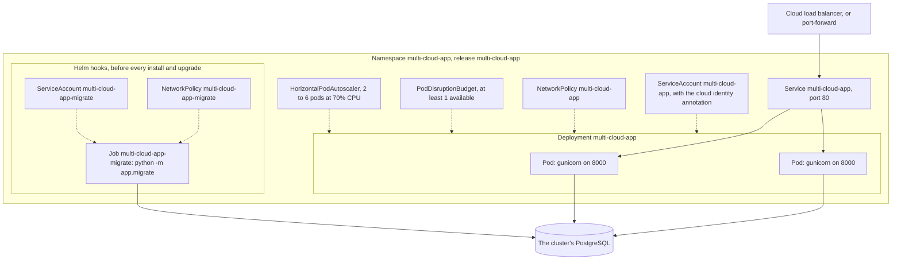
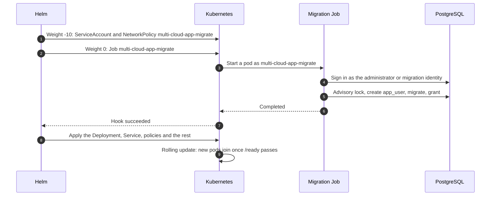
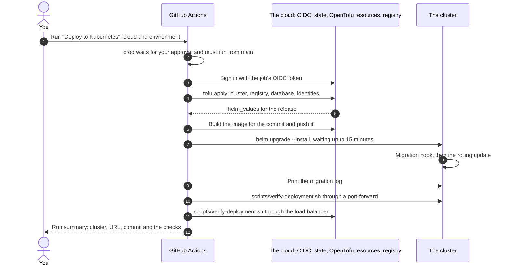

# Kubernetes architecture

One Helm chart, [`deploy/helm/multi-cloud-app`](../deploy/helm/multi-cloud-app), runs the service on
EKS Auto Mode, GKE Autopilot and AKS, and on a local or CI kind cluster. The clusters themselves,
their networks, databases and cloud identities are described per cloud:
[AWS (EKS)](aws-architecture.md#eks-auto-mode), [Google Cloud (GKE)](gcp-architecture.md#gke-autopilot)
and [Azure (AKS)](azure-architecture.md#aks). This page covers what the chart puts in a cluster,
how a deployment rolls out, and how to check it. Setting up and running the deployment is in
[kubernetes-deployment.md](kubernetes-deployment.md).

- [In the cluster](#in-the-cluster)
- [Every object the chart creates](#every-object-the-chart-creates)
- [The pods](#the-pods)
- [The migration hook](#the-migration-hook)
- [Network policies](#network-policies)
- [Each cloud's values](#each-clouds-values)
- [Deployment flow](#deployment-flow)
- [Verify a deployment](#verify-a-deployment)
- [How CI tests the chart](#how-ci-tests-the-chart)
- [Check it without a cluster](#check-it-without-a-cluster)
- [Not included](#not-included)

## In the cluster



The release is installed as `multi-cloud-app` in the namespace `multi-cloud-app`. Because the
release name contains the chart's name, objects are named `multi-cloud-app`, and the migration's
`multi-cloud-app-migrate`; the clouds' identities trust exactly those service account names.

## Every object the chart creates

| Template | Object | Created when | Purpose |
| --- | --- | --- | --- |
| `templates/deployment.yaml` | Deployment `multi-cloud-app` | Always | Runs the service's pods |
| `templates/service.yaml` | Service `multi-cloud-app` | Always | Port 80 to the pods' 8000; `ClusterIP` by default, `LoadBalancer` on the clouds |
| `templates/serviceaccount.yaml` | ServiceAccount `multi-cloud-app` | `serviceAccount.create` (default on) | The pods' identity, annotated for the cloud's workload identity |
| `templates/hpa.yaml` | HorizontalPodAutoscaler | `autoscaling.enabled` (default on) | 2 to 6 pods, aiming at 70% CPU |
| `templates/pdb.yaml` | PodDisruptionBudget | `podDisruptionBudget.enabled` (default on) | Keeps at least 1 pod during node maintenance |
| `templates/networkpolicy.yaml` | NetworkPolicy `multi-cloud-app` | `networkPolicy.enabled` (default on) | Lets in only the HTTP port; lets out only DNS, the database and the cloud's identity endpoint |
| `templates/ingress.yaml` | Ingress | `ingress.enabled` (default off) | An optional Ingress with TLS, for a cluster with an ingress controller |
| `templates/migration-serviceaccount.yaml` | ServiceAccount `multi-cloud-app-migrate` (hook) | `database.enabled` and `database.migrations.enabled` | The migration's own identity |
| `templates/migration-networkpolicy.yaml` | NetworkPolicy `multi-cloud-app-migrate` (hook) | The same, and `networkPolicy.enabled` | Nothing in; out only DNS, the database and the identity endpoints |
| `templates/migration-job.yaml` | Job `multi-cloud-app-migrate` (hook) | `database.enabled` and `database.migrations.enabled` | Runs `python -m app.migrate` before the new pods start |
| `templates/tests/test-connection.yaml` | Pod `multi-cloud-app-test` | `helm test` only | Calls `/ready` through the Service |
| `templates/NOTES.txt` | | Install output | How to reach the release |
| `templates/_helpers.tpl` | | | Names, labels, the `DB_*` settings and the egress rules every template shares |

Every object carries `app.kubernetes.io/name`, `app.kubernetes.io/instance`,
`app.kubernetes.io/version` (the commit), `app.kubernetes.io/managed-by` and `helm.sh/chart`. The
migration's pods are labelled `app.kubernetes.io/name: multi-cloud-app-migrate`, so the Service,
the service's network policy and the disruption budget never select them.

## The pods

| Setting | Value | Why |
| --- | --- | --- |
| Image | `<registry>/multi-cloud-app:<commit>` | The deploy workflow sets the repository and the commit SHA as the tag |
| Environment | `APP_ENV`, `APP_VERSION=<commit>`, `PORT=8000`, and the cloud's `DB_*` settings | `/health` reports the commit; the database settings come from `database.*` |
| Rollout | `RollingUpdate`, at most 1 extra pod, none unavailable; 5 old ReplicaSets kept | Capacity never drops during a deployment |
| Probes | Startup `/health` every 2 seconds, up to 30 times; readiness `/ready` every 5 seconds, 3-second timeout; liveness `/health` every 10 seconds, 3 failures | Traffic only reaches pods that can query the database; a database outage never restarts pods |
| Resources | Requests 250m CPU and 256 Mi; limit 512 Mi | Autopilot and the autoscaler size nodes from requests |
| User | UID and GID 10001, non-root, `fsGroup` 10001, seccomp `RuntimeDefault` | |
| Container | No privilege escalation, read-only root filesystem, all Linux capabilities dropped | |
| Writable paths | `/tmp`, a 64 Mi `emptyDir` | gunicorn's heartbeat files go to `/dev/shm` |
| Service account token | Not mounted (`automountServiceAccountToken: false`) | The app never calls the Kubernetes API; the clouds' identity webhooks mount their own tokens |
| Spread | Across zones, at most one pod's difference (`ScheduleAnyway`) | Survives a zone outage where the cluster has several |

## The migration hook

Helm runs hooks in weight order before it touches the release's other objects:



- The hooks run before every `helm install` (`pre-install`) and `helm upgrade` (`pre-upgrade`).
- The Job retries once (`backoffLimit: 1`) and is stopped after 10 minutes
  (`activeDeadlineSeconds: 600`). If it fails, the install or upgrade fails and the running pods
  keep serving the old version.
- Each hook object is deleted when the next deployment creates it again
  (`before-hook-creation`), so the finished Job and its log stay until then:
  `kubectl logs job/multi-cloud-app-migrate`.
- The Job gets the same pod and container security settings as the service, a `/tmp` volume, and
  requests of 100m CPU and 192 Mi (limit 384 Mi).
- How it signs in differs per cloud: see [each cloud's values](#each-clouds-values).

## Network policies

Both policies deny all traffic that a rule doesn't allow. The service's pods accept only TCP on
their HTTP port, from anywhere (the load balancer, other pods, `kubectl port-forward`); the
migration's pods accept nothing. Outbound, both may reach:

| Destination | Port | EKS | GKE | AKS | kind |
| --- | --- | --- | --- | --- | --- |
| DNS | 53 UDP and TCP | yes | yes | yes | yes |
| The database | 5432 (GKE: the Cloud SQL connector's 3307) | The database subnets | The private services range | The database subnet | Anywhere |
| EKS Pod Identity Agent | `169.254.170.23/32` port 80 | yes | | | |
| GKE metadata server | `169.254.169.254/32` port 80, `169.254.169.252/32` port 988 | | yes | | |
| HTTPS anywhere | 443 | Migration Job only (Secrets Manager) | yes (Cloud SQL Admin API, token exchange) | yes (Microsoft Entra ID) | |

The address ranges come from OpenTofu's `helm_values`; the rest is in each cloud's values file.
Dataplane V2 on GKE and Cilium on AKS enforce the policies; on EKS Auto Mode they are enforced
once network policies are turned on for the cluster.

## Each cloud's values

| | `values-eks.yaml` | `values-gke.yaml` | `values-aks.yaml` | `values-kind.yaml` |
| --- | --- | --- | --- | --- |
| Service | `LoadBalancer`, class `eks.amazonaws.com/nlb`, internet-facing, pod IP targets, health check `/health` | `LoadBalancer` (external passthrough Network Load Balancer) | `LoadBalancer`, health probe `/health` | `ClusterIP` |
| Service signs in with | `aws-iam` | `gcp-iam` (with `DB_CONNECT_TIMEOUT=10`) | `azure-entra` | `password` from the Secret `app-db` |
| Migration signs in with | `password`, read from Secrets Manager (`DB_PASSWORD_SECRET_ARN`) | `gcp-iam` as the migration service account | `azure-entra` as the server's Entra administrator | `password` from the Secret `postgres-admin` |
| Pods get their cloud identity from | EKS Pod Identity (association by service account name) | The `iam.gke.io/gcp-service-account` annotation | The `azure.workload.identity/client-id` annotation and the `azure.workload.identity/use` pod label | |
| TLS to the database | `verify-full` with the RDS roots | The connector's mutual TLS | `verify-full` with public roots | Off (throwaway server) |

On a cloud, the deploy workflow adds OpenTofu's `helm_values` output on top. It turns
`database.enabled` on and sets the server (`host`, or `instance` on GKE), the database and user
names, the migration user, the egress ranges, and the identity annotations. The files in
[`ci/`](../deploy/helm/multi-cloud-app/ci) are examples of it, one per cloud. Every setting is
documented in [values.yaml](../deploy/helm/multi-cloud-app/values.yaml).

## Deployment flow



Every step of [deploy-kubernetes.yml](../.github/workflows/deploy-kubernetes.yml), in order:

| # | Step | Runs for | What happens | How to check it |
| --- | --- | --- | --- | --- |
| 1 | Allow production deployments only from main | `prod` from another branch | Stops the run. The `prod` environment also waits for your approval before the job starts. | A run from another branch fails here. |
| 2 | `actions/checkout` | All | Checks out the commit being deployed. | |
| 3 | Check required configuration | All | Fails fast if the chosen cloud's variables or secrets are missing from the environment. | The error names the setting. |
| 4 | Export OpenTofu variables | All | Passes the environment, the namespace and release name (which the identities trust), and the cloud's project, region, group or registry names as `TF_VAR_*`. | |
| 5 | Authenticate to Google Cloud | `gke` | Signs in as the deployer service account through Workload Identity Federation. | |
| 6 | `google-github-actions/setup-gcloud` | `gke` | Installs gcloud. | |
| 7 | Authenticate to Azure | `aks` | Signs in as the Entra app; OpenTofu reuses the token. | |
| 8 | Authenticate to AWS | `eks` | Assumes the deploy role. | |
| 9 | `opentofu/setup-opentofu` | All | Installs OpenTofu. | |
| 10 | `azure/setup-helm` | All | Installs Helm 4.3.0. | |
| 11 | Initialize OpenTofu state | All | `tofu init` with state at `multi-cloud-<cloud>/<environment>` in the cloud's state store. | |
| 12 | Create or update the cluster | All | `tofu apply` for `infra/<cloud>`: the cluster, registry, database and identities; then writes the `helm_values` output to a file for step 16. The first run takes 15 to 30 minutes. | The plan in the log; the cluster in the cloud's console. |
| 13 | Build and push image | All | Logs in to the cloud's registry, builds the image with the commit SHA as its tag and `APP_VERSION`, and pushes it (on EKS, skipped if the immutable tag exists). | The image in the registry. |
| 14 | Get GKE credentials | `gke` | Writes a kubeconfig for the cluster. | |
| 15 | Get AKS or EKS credentials | `aks`, `eks` | `az aks get-credentials` or `aws eks update-kubeconfig`. | |
| 16 | Install or upgrade the release | All | `helm upgrade --install` with `values-<cloud>.yaml`, the `helm_values` file and the image, waiting up to 15 minutes. The migration hook runs first; a failed migration fails the upgrade and leaves the old pods serving. | `helm history multi-cloud-app -n multi-cloud-app` |
| 17 | Show the migration log | All, even after a failure | Prints `kubectl logs job/multi-cloud-app-migrate`. | The migrations applied, and `Database app is at revision ...`. |
| 18 | Verify the deployment end to end | All | Runs [scripts/verify-deployment.sh](../scripts/verify-deployment.sh) through a port-forward to the Service (writing an item in `dev`), waits up to 5 minutes for the load balancer's address, then runs the read-only checks through the load balancer for up to 10 minutes. Sets the environment's URL. | The run summary's two tables. |

## Verify a deployment

After getting the cluster's credentials (see each cloud's page):

```bash
NS=multi-cloud-app
helm status multi-cloud-app -n "$NS"
helm history multi-cloud-app -n "$NS"

# Pods ready on the new commit, the Job completed, the policies in place
kubectl get deployment,pods,service,job,hpa,pdb,networkpolicy -n "$NS" -o wide
kubectl get pods -n "$NS" -L app.kubernetes.io/version
kubectl logs job/multi-cloud-app-migrate -n "$NS"

# Each service account's cloud identity
kubectl get serviceaccounts -n "$NS" -o yaml | grep -E 'name:|iam.gke.io|workload.identity'

# The pods' security settings
kubectl get pod -n "$NS" -l app.kubernetes.io/name=multi-cloud-app \
  -o jsonpath='{.items[0].spec.securityContext}{"\n"}{.items[0].spec.containers[0].securityContext}{"\n"}'

# The chart's own test, then the workflow's checks
helm test multi-cloud-app -n "$NS"
kubectl port-forward -n "$NS" service/multi-cloud-app 8080:80 &
scripts/verify-deployment.sh http://127.0.0.1:8080 <commit SHA>
```

## How CI tests the chart

Every pull request, through the shared [`helm.yml`](https://github.com/Naresh1401/github-cicd-workflows):

1. `helm lint --strict` and `kubeconform` against Kubernetes 1.35 for `values.yaml` alone, each
   cloud's values file, each cloud's values with its `ci/` example of OpenTofu's output (so the
   migration Job, network policies and identity annotations are checked as each cloud renders
   them), and `values-kind.yaml`.
2. A kind cluster: CI builds the image from the commit, applies the throwaway PostgreSQL in
   [`deploy/kind/postgres.yaml`](../deploy/kind/postgres.yaml), installs the chart with
   `values-kind.yaml` (the migration hook must succeed), checks that `/ready` reports the commit
   and `"database": "ok"`, and runs `helm test`.

## Check it without a cluster

```bash
make helm-check     # lint and render every combination CI checks

# The manifests a cloud would get, with the example OpenTofu values
helm template multi-cloud-app deploy/helm/multi-cloud-app --namespace multi-cloud-app \
  --values deploy/helm/multi-cloud-app/values-eks.yaml \
  --values deploy/helm/multi-cloud-app/ci/eks-database-values.yaml
```

With Docker and kind, [kubernetes-deployment.md](kubernetes-deployment.md#try-it-locally) runs the
same install as CI on your machine.

## Not included

- **TLS at the edge:** the clouds' load balancers serve HTTP. The chart's optional Ingress takes
  TLS settings, but no ingress controller, cert-manager or DNS automation is installed.
- **Pod Security Admission labels** on the namespace; the pods already meet the `restricted`
  profile.
- **Resource quotas and limit ranges** for the namespace.
- **Progressive delivery** (canary or blue/green, for example Argo Rollouts) and a **service mesh**
  for mutual TLS between pods.
- **Cluster-level backups**: the release keeps no state in the cluster; the data is in the
  managed database, which is backed up.
